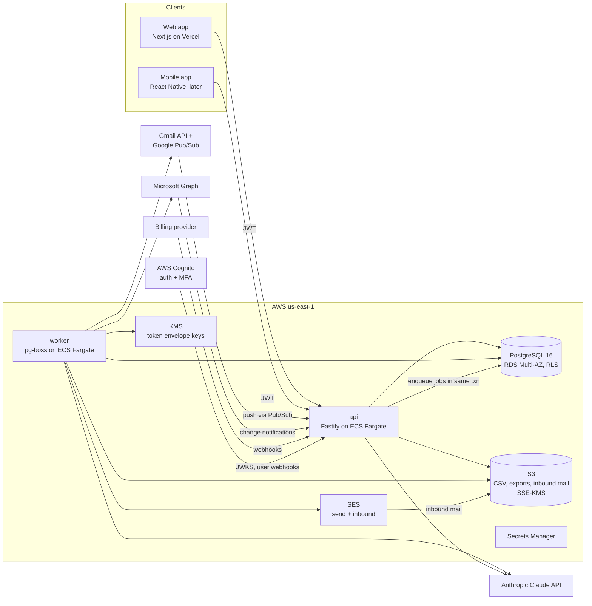

# MoneyPilot AI: Backend Plan v1.0 (MVP → P1)

This is the implementation plan for the server side of MoneyPilot: architecture, data model, APIs, background jobs, email capture, the planning engine, AI, security, cost and delivery. Read it together with [DESIGN_SPEC.md](DESIGN_SPEC.md), which defines what each screen shows and the calculation rules (§6), and with `design/fixtures/rivera-household.json`, the golden data every number is tested against.

**Assumptions**
- US launch, web first, mobile (React Native) later.
- The company is operated from India.
- Two senior full-stack TypeScript engineers, plus a part-time designer.
- Validation (Days 1–30) happens before most of this is built.

If any assumption is wrong, see §17.

---

## 0. Summary

| Topic | Decision |
|---|---|
| Shape | **Modular monolith.** One TypeScript codebase, deployed as two processes: `api` (HTTP) and `worker` (background jobs). No microservices. |
| Language / runtime | TypeScript on Node.js 22 LTS. |
| API | Fastify 5, Zod schemas, generated OpenAPI 3.1, and a typed client shared by web and mobile. |
| Database | PostgreSQL 16 with **row-level security (RLS)** for household isolation. Drizzle ORM and SQL migrations. |
| Jobs | **pg-boss** (a Postgres-backed queue with retries, cron and singleton keys). No Redis in the MVP. |
| Auth | AWS Cognito with MFA behind an adapter (ADR-017). Our own `users` table keyed by the auth subject. |
| Planning math | `packages/engine`: pure, deterministic TypeScript, tested against the golden fixture. **AI never computes numbers.** |
| Email capture | Gmail API (read-only), Microsoft Graph (Mail.Read), plus a per-household forwarding address over inbound email. Rules prefilter, then one AI extraction call per message, then rule validation, then the review queue. |
| AI | Anthropic Claude API, `claude-opus-5-5` by default (see §7.9). Structured outputs for extraction; tool use limited to engine functions for Ask. |
| Hosting | AWS `us-east-1`: RDS, ECS Fargate, S3, KMS, SES, Secrets Manager. Web on Vercel. Infrastructure as code with AWS CDK (TypeScript). |
| Not built | Moving money (FR-12), bank connections until P1 evidence (FR-08), storing email bodies. |

**MVP backend scope** (Days 31–60): households and invites, items and schedules, occurrences, the planning engine and plan API, calendar, goals and proposals, tasks, renewals, reminders, CSV import, email capture (forwarding, Gmail, Outlook) with the review queue, privacy controls, audit log, and billing.
**P1** (Days 61–90+, evidence-gated): AI summaries in production, Ask MoneyPilot, bank connections (Plaid) behind the adapter, mobile push, realtime updates.

---

## 1. Requirements → backend modules

| Requirement | Module(s) | Section |
|---|---|---|
| FR-01 Household + partner invite | `households`, `auth` | §6 |
| FR-02 Income, bills, recurring | `items`, `schedules` | §7.1 |
| FR-03 Shared calendar | `items`, `engine` (`calendar`) | §7.1, §7.2 |
| FR-04 Goals + planned expenses | `goals`, `proposals` | §7.3 |
| FR-05 Owners + tasks | `items`, `tasks` | §7.4 |
| FR-06 Reminders | `notify` | §7.6 |
| FR-07 CSV import | `imports`, `detection` | §7.7 |
| FR-08 Bank connection (P1) | `bank` adapter | §7.12 |
| FR-09 Recurring and price-change detection | `detection`, `engine` (flags) | §7.2, §7.7 |
| FR-10 AI summaries | `ai` | §7.9 |
| FR-11 Suggested dates, action plan | `engine` (what-if, shortfall options) | §7.2 |
| FR-13 Email capture | `email`, `ai`, `review` | §7.8 |
| FR-14 Subscriptions & renewals | `items` (`renewal_details`), `engine` (renewals) | §7.5 |
| NFR privacy, security, audit | `privacy`, `audit`, platform | §7.11, §10 |
| Billing | `billing` | §7.10 |

---

## 2. Architecture



**Principles**
1. **One database, one source of truth.** Jobs are rows in Postgres (pg-boss), enqueued in the same transaction as the data change. That gives us the outbox pattern for free.
2. **The household is the tenant.** Every household-owned row has `household_id`, and RLS enforces isolation even if application code has a bug.
3. **Deterministic core, AI at the edges.** The engine computes every number. AI extracts fields from emails and writes explanations, and its output is always validated by rules.
4. **Idempotent everything.** Webhooks, jobs, imports and email messages each have a natural unique key.
5. **Minimize what we store.** No email bodies, no full account numbers, no raw CSV after processing.

### 2.1 Repository layout (pnpm workspaces + Turborepo)

```
apps/
  web/                 Next.js (App Router). UI only; talks to api.
  mobile/              React Native CLI app, no Expo (after web validation; ADR-016)
  api/                 Fastify server: routes, auth, validation, webhooks
  worker/              pg-boss workers + cron schedules
packages/
  engine/              Pure planning math (no I/O). Golden + property tests.
  db/                  Drizzle schema, SQL migrations, RLS policies, seed (fixture loader)
  contracts/           Zod schemas → OpenAPI; generated TS client for web/mobile
  format/              Money/date formatting per DESIGN_SPEC §7 (shared by web + mobile)
  email/               Gmail/Graph/forwarding adapters, MIME → text, prefilter rules
  ai/                  Claude client wrapper, prompts (versioned), schemas, evals
  detection/           CSV parsing, merchant normalization, recurring detection
  notify/              Email/push rendering + delivery adapters
  billing/             Provider adapter + entitlements
  bank/                Provider adapter interface (P1, disabled)
  crypto/              KMS envelope encryption helpers
  observability/       OpenTelemetry, pino logger with redaction
infra/                 AWS CDK app (TypeScript)
design/                tokens, fixtures (existing)
docs/                  DESIGN_SPEC.md, BACKEND_PLAN.md, ADRs
```

Dependency rules, enforced with a lint rule:
- `engine` depends on nothing internal.
- Apps may depend on packages; packages never depend on apps.
- Only `worker` imports `email`, `ai` (extraction) and `crypto` decryption.

---

## 3. Tech stack and reasons

| Concern | Choice | Why | Alternative |
|---|---|---|---|
| HTTP framework | Fastify 5 + `fastify-type-provider-zod` | Fast, schema-first, OpenAPI generation | NestJS (heavier), Hono |
| Validation & contracts | Zod → OpenAPI 3.1 → `openapi-typescript` client | One schema serves runtime validation, docs and client types | tRPC (TS-only; harder for third parties) |
| ORM / migrations | Drizzle ORM + drizzle-kit; RLS in raw SQL migrations | SQL-first, transparent queries, works with `SET LOCAL` | Prisma (RLS is awkward), Kysely |
| Database | PostgreSQL 16 (RDS Multi-AZ in prod) | RLS, JSONB, strong consistency, pg-boss | Neon/Supabase for a cheaper pilot |
| Jobs / cron | pg-boss | Transactional enqueue, retries, cron, singleton keys, no extra infra | SQS + EventBridge when scale demands |
| Dates | `@js-temporal/polyfill` (`PlainDate`, `ZonedDateTime`) | Date-only bill logic without timezone bugs | date-fns-tz |
| Recurrence | RFC 5545 RRULE via the `rrule` library | Standard; covers all our schedules | Custom schedule JSON |
| Auth | AWS Cognito (TOTP MFA, passkeys, Google federation); Amplify Auth on web and bare React Native; `aws-jwt-verify` in the API (ADR-017) | Same cloud as hosting, works without Expo, cheap at scale | Auth0 (react-native-auth0), Clerk |
| Files | S3 + SSE-KMS, presigned uploads | Standard, cheap, encrypted | — |
| Email send | Amazon SES (transactional, with configuration sets for events) | Cheap; delivery events via SNS | Postmark |
| Inbound email | SES receiving → S3 → SNS → worker | Same vendor, encrypted at rest | Postmark inbound |
| Push (later) | Firebase Cloud Messaging via `@react-native-firebase/messaging` (FCM for Android, APNs through FCM for iOS) | No Expo dependency | Direct APNs + FCM from the worker, OneSignal |
| AI | Anthropic Claude API (`@anthropic-ai/sdk`) | Structured outputs, tool use, Batch API, prompt caching | — |
| Secrets / keys | AWS Secrets Manager + KMS | Envelope encryption for OAuth tokens | HashiCorp Vault |
| IaC | AWS CDK (TypeScript) | One language across the stack | Terraform |
| CI/CD | GitHub Actions → ECR → ECS; Vercel for web | Simple | — |
| Observability | OpenTelemetry → Grafana Cloud (or Datadog); Sentry; pino logs | Vendor-neutral traces | — |
| Product analytics | PostHog. Events carry **no amounts, names or merchant strings** | Funnels and retention | — |

---

## 4. Environments, hosting, CI/CD

| Env | Purpose | Data |
|---|---|---|
| `local` | Docker Compose: Postgres 16, MinIO (S3), Mailpit (SMTP), a fake Gmail/Graph server | Fixture seed (`rivera-household.json`) |
| `dev` | Shared integration, auto-deploy from `main` | Synthetic only |
| `staging` | Production-like, with Gmail and Graph test apps | Synthetic and pilot test accounts |
| `prod` | Pilot and beta households | Real. Access via break-glass only. |

- **Region:** AWS `us-east-1` for all data, including backups. Claude requests set `inference_geo: "us"` (§7.9).
- **Network:** API and worker run in private subnets behind an ALB; RDS runs in isolated subnets. Egress goes through a NAT gateway. Webhooks reach the ALB on dedicated paths, each verified (§8.4).
- **Deploys:**
  - The pipeline runs lint → typecheck → unit → integration (Testcontainers Postgres, including RLS tests) → build images → migrate (a gated step using the `mp_migrator` role) → rolling deploy to api and worker.
  - Migrations are backward-compatible (expand, then contract) so a rolling deploy never breaks.
- **Secrets:** stored in Secrets Manager and injected into ECS tasks. Nothing secret is kept in env files in the repo.
- **Backups:** RDS automated backups with point-in-time recovery (PITR) for 14 days, plus a weekly snapshot kept for 35 days. Restore drills run quarterly.

---

## 5. Data model

### 5.1 Conventions
- Primary keys are `uuid` (`gen_random_uuid()`); the audit log uses `bigserial`.
- **Money is `bigint` cents**, always USD in the MVP (`households.currency` is ready for later). The API returns integer cents. Formatting happens in `packages/format`.
- **Dates:** due dates are `date` (household-local calendar dates); events are `timestamptz` (UTC). Every household has an IANA `timezone`.
- Every household-owned table has `household_id` with `ON DELETE CASCADE` from `households`, and RLS enabled **and forced**.
- Soft delete (`deleted_at`) only where undo or history matters (items, goals). Everything else is hard-deleted.
- Tables partners edit (`households`, `recurring_items`, `occurrences`, `planned_expenses`, `goals`, `tasks`) carry `version int not null default 1`. It is incremented by a trigger on update and checked against `If-Match` (§8.1). The DDL below shows it on `recurring_items`; add it to the others the same way.
- Never store: full account or policy numbers (last 4 only), email bodies, OAuth tokens in plaintext, card data (the billing provider holds it).

### 5.2 Schema (DDL, abbreviated where obvious)

```sql
create extension if not exists pgcrypto;
create extension if not exists citext;

-- ===== Identity & households =====
create table users (
  id            uuid primary key default gen_random_uuid(),
  auth_subject  text not null unique,              -- Cognito `sub`
  email         citext not null unique,
  first_name    text not null,
  last_name     text,
  timezone      text not null default 'America/New_York',
  mfa_enabled   boolean not null default false,    -- synced from verified token claims (ADR-017)
  created_at    timestamptz not null default now(),
  deleted_at    timestamptz
);

create table households (
  id                     uuid primary key default gen_random_uuid(),
  name                   text not null check (char_length(name) between 1 and 80),
  timezone               text not null,
  currency               char(3) not null default 'USD',
  cushion_cents          bigint not null default 50000 check (cushion_cents >= 0),
  primary_income_item_id uuid,                     -- FK added below
  plan                   text not null default 'free' check (plan in ('free','family_plus')),
  forwarding_token       text not null unique,      -- local part, e.g. "rivera-7k2"
  created_by             uuid not null references users(id),
  deletion_scheduled_for timestamptz,
  created_at             timestamptz not null default now(),
  updated_at             timestamptz not null default now()
);

create table household_members (
  household_id uuid not null references households(id) on delete cascade,
  user_id      uuid not null references users(id),
  color_role   text not null check (color_role in ('partnerA','partnerB')),
  is_creator   boolean not null default false,
  joined_at    timestamptz not null default now(),
  left_at      timestamptz,
  primary key (household_id, user_id)
);
create unique index household_members_color_uq on household_members(household_id, color_role) where left_at is null;
create index household_members_user_idx on household_members(user_id) where left_at is null;

create table invites (
  id           uuid primary key default gen_random_uuid(),
  household_id uuid not null references households(id) on delete cascade,
  email        citext not null,
  token_hash   bytea not null unique,                -- sha256 of the random token; token only in email link
  invited_by   uuid not null references users(id),
  expires_at   timestamptz not null,                 -- 7 days
  accepted_at  timestamptz,
  revoked_at   timestamptz,
  created_at   timestamptz not null default now()
);

-- ===== Recurring items (bills, subscriptions, insurance, memberships, registrations, income) =====
create type item_direction as enum ('outflow','inflow');
create type item_kind as enum ('bill','subscription','insurance','membership','registration','loan','income','other');
create type owner_type as enum ('member','both','split');

create table recurring_items (
  id               uuid primary key default gen_random_uuid(),
  household_id     uuid not null references households(id) on delete cascade,
  direction        item_direction not null,
  kind             item_kind not null,
  category         text not null,        -- housing|utilities|childcare|transport|debt|subscription|insurance|membership|vehicle_home|income|other
  name             text not null check (char_length(name) between 1 and 80),
  provider_name    text,
  provider_domain  text,                 -- used to match emails, e.g. "northgate-insurance.example"
  amount_type      text not null check (amount_type in ('fixed','estimated','statement')),
  amount_cents     bigint check (amount_cents >= 0),
  rrule            text not null,        -- RFC 5545, e.g. 'FREQ=MONTHLY;BYMONTHDAY=-1'
  dtstart          date not null,
  until            date,
  weekend_rule     text not null default 'none' check (weekend_rule in ('none','prev_business_day','next_business_day')),
  owner_type       owner_type not null,
  owner_user_id    uuid references users(id),
  status           text not null default 'active' check (status in ('active','paused','ended','pending_review')),
  source           text not null check (source in ('manual','csv','email','bank')),
  account_last4    text check (account_last4 ~ '^[0-9A-Za-z]{2,4}$'),
  paid_from        text not null default 'account' check (paid_from in ('account','payroll')),  -- payroll = excluded from runway
  marked_possibly_unused boolean not null default false,
  subcategory      text,                 -- groups items for the possible-duplicate flag, e.g. 'music' (DESIGN_SPEC §6 rule 8)
  movable          boolean,              -- user override for shortfall option 3; null = default by kind (DESIGN_SPEC §6 rule 18)
  on_bills_page    boolean not null default true,  -- false for items that exist only as renewals (DESIGN_SPEC §6 rule 17, Q-020)
  notes            text,
  version          int not null default 1,          -- If-Match concurrency (§8.1)
  created_by       uuid references users(id),
  created_at       timestamptz not null default now(),
  updated_at       timestamptz not null default now(),
  deleted_at       timestamptz,
  check ((owner_type = 'member') = (owner_user_id is not null)),
  check (amount_type <> 'fixed' or amount_cents is not null)
);
create index recurring_items_household_idx on recurring_items(household_id) where deleted_at is null;
create index recurring_items_domain_idx on recurring_items(household_id, provider_domain) where deleted_at is null;
alter table households add constraint households_primary_income_fk
  foreign key (primary_income_item_id) references recurring_items(id) deferrable initially deferred;

create table renewal_details (                       -- 1:1 for insurance/membership/registration/yearly subs
  item_id               uuid primary key references recurring_items(id) on delete cascade,
  household_id          uuid not null references households(id) on delete cascade,
  auto_renews           text not null default 'yes' check (auto_renews in ('yes','no','rolls_over')),
  coverage_start        date,
  coverage_end          date,
  cancel_by             date,
  decision_by           date,
  shop_around_on        date,                         -- renewal − 30 days (DESIGN_SPEC §6 rule 11)
  previous_amount_cents bigint,
  price_changed_on      date,
  document_s3_key       text                          -- e.g. policy declarations PDF from email
);

create table item_amount_history (                   -- feeds estimates (rule 6) and price-change flags (rule 8)
  id           uuid primary key default gen_random_uuid(),
  household_id uuid not null references households(id) on delete cascade,
  item_id      uuid not null references recurring_items(id) on delete cascade,
  occurred_on  date not null,
  amount_cents bigint not null,
  source       text not null check (source in ('manual','csv','email','bank')),
  created_at   timestamptz not null default now(),
  unique (item_id, occurred_on, source)
);

create table occurrences (                            -- materialized ~400 days ahead (§7.1)
  id                  uuid primary key default gen_random_uuid(),
  household_id        uuid not null references households(id) on delete cascade,
  item_id             uuid not null references recurring_items(id) on delete cascade,
  scheduled_on        date not null,                  -- from the rule
  due_on              date not null,                  -- after weekend rule / manual move
  actual_amount_cents bigint,                         -- set when a statement/actual arrives
  status              text not null default 'scheduled' check (status in ('scheduled','paid','received','skipped')),
  paid_on             date,
  marked_by           uuid references users(id),
  moved_by            uuid references users(id),
  unique (item_id, scheduled_on)
);
create index occurrences_household_due_idx on occurrences(household_id, due_on);

create table planned_expenses (
  id            uuid primary key default gen_random_uuid(),
  household_id  uuid not null references households(id) on delete cascade,
  name          text not null,
  amount_cents  bigint not null check (amount_cents > 0),
  due_on        date not null,
  owner_type    owner_type not null,
  owner_user_id uuid references users(id),
  goal_id       uuid,                                  -- paid from a goal (e.g. Tahoe trip)
  status        text not null default 'planned' check (status in ('planned','done','cancelled')),
  created_by    uuid references users(id),
  created_at    timestamptz not null default now()
);

create table balances (                                 -- starting point of the runway
  id           uuid primary key default gen_random_uuid(),
  household_id uuid not null references households(id) on delete cascade,
  label        text not null default 'Checking',
  amount_cents bigint not null,
  as_of        date not null,
  source       text not null check (source in ('manual','csv','bank')),
  recorded_by  uuid references users(id),
  created_at   timestamptz not null default now()
);
create index balances_latest_idx on balances(household_id, as_of desc, created_at desc);

-- ===== Goals, proposals, tasks =====
create table goals (
  id            uuid primary key default gen_random_uuid(),
  household_id  uuid not null references households(id) on delete cascade,
  name          text not null,
  type          text not null check (type in ('savings','planned_expense')),
  target_cents  bigint not null check (target_cents > 0),
  saved_cents   bigint not null default 0 check (saved_cents >= 0),
  monthly_cents bigint not null default 0 check (monthly_cents >= 0),
  target_date   date,
  color_slot    smallint not null default 1 check (color_slot between 1 and 3),
  is_emergency_fund boolean not null default false,  -- the goal shortfall option 1 draws from (DESIGN_SPEC §5.3)
  status        text not null default 'active' check (status in ('active','reached','archived')),
  created_by    uuid references users(id),
  created_at    timestamptz not null default now(),
  updated_at    timestamptz not null default now(),
  deleted_at    timestamptz
);
create unique index goals_one_emergency_fund on goals(household_id) where is_emergency_fund and deleted_at is null;

create table goal_events (                              -- user-recorded deposits/withdrawals (we never move money)
  id           uuid primary key default gen_random_uuid(),
  household_id uuid not null references households(id) on delete cascade,
  goal_id      uuid not null references goals(id) on delete cascade,
  kind         text not null check (kind in ('deposit','withdrawal','adjustment')),
  amount_cents bigint not null,
  occurred_on  date not null,
  recorded_by  uuid references users(id),
  created_at   timestamptz not null default now()
);

create table proposals (                                -- "Ask Jordan to approve"
  id               uuid primary key default gen_random_uuid(),
  household_id     uuid not null references households(id) on delete cascade,
  kind             text not null check (kind in ('goal_change','item_change','shortfall_option','plan_option')),
  payload          jsonb not null,                    -- validated diff (contracts.ProposalPayload)
  calc_snapshot_id uuid,                              -- the math shown when proposed
  proposed_by      uuid not null references users(id),
  status           text not null default 'pending' check (status in ('pending','approved','rejected','expired','applied','superseded')),
  decided_by       uuid references users(id),
  decided_at       timestamptz,
  expires_at       timestamptz not null,              -- 7 days
  created_at       timestamptz not null default now(),
  check (decided_by is null or decided_by <> proposed_by)
);

create table tasks (
  id                 uuid primary key default gen_random_uuid(),
  household_id       uuid not null references households(id) on delete cascade,
  title              text not null check (char_length(title) between 1 and 140),
  owner_type         owner_type not null,
  owner_user_id      uuid references users(id),
  due_on             date,
  due_hint           text,                            -- "When the bill arrives, about Nov 1"
  linked_item_id     uuid references recurring_items(id) on delete set null,
  source             text not null check (source in ('user','engine','email','renewal','setup')),
  auto_complete_rule jsonb,                           -- e.g. {"type":"actual_amount_received","item_id":"..."}
  completed_at       timestamptz,
  completed_by       uuid references users(id),       -- null when auto-completed
  completed_reason   text,
  created_by         uuid references users(id),
  created_at         timestamptz not null default now()
);
create index tasks_open_idx on tasks(household_id, due_on) where completed_at is null;

-- ===== Email capture =====
create table email_connections (
  id               uuid primary key default gen_random_uuid(),
  household_id     uuid not null references households(id) on delete cascade,
  user_id          uuid not null references users(id),      -- only this member can manage it
  provider         text not null check (provider in ('gmail','outlook')),
  address_masked   text not null,                            -- "sam•••@gmail.com"
  address_hash     bytea not null,                           -- HMAC for matching, no plaintext address
  scopes           text[] not null,
  token_ciphertext bytea not null,                           -- KMS envelope-encrypted refresh token
  token_dek_wrapped bytea not null,
  token_key_id     text not null,
  status           text not null default 'active' check (status in ('active','paused','error','revoked')),
  sync_cursor      text,                                     -- Gmail historyId / Graph deltaLink
  watch_expires_at timestamptz,
  last_synced_at   timestamptz,
  last_error       text,
  created_at       timestamptz not null default now(),
  revoked_at       timestamptz,
  unique (household_id, user_id, provider, address_hash)
);

create table email_messages (                               -- one row per message we looked at; no bodies
  id                  uuid primary key default gen_random_uuid(),
  household_id        uuid not null references households(id) on delete cascade,
  connection_id       uuid references email_connections(id) on delete set null,
  channel             text not null check (channel in ('gmail','outlook','forward')),
  provider_message_id text not null,
  received_at         timestamptz not null,
  from_domain         text not null,
  subject             text,                                   -- kept only if an item was extracted (shown in review)
  stage               text not null check (stage in ('prefiltered_out','irrelevant','extracted','failed','quarantined')),
  truncated           boolean not null default false,
  processed_at        timestamptz,
  created_at          timestamptz not null default now()
);
create unique index email_messages_uq on email_messages
  (channel, coalesce(connection_id, '00000000-0000-0000-0000-000000000000'::uuid), provider_message_id);

create table extracted_items (                              -- the review queue
  id                uuid primary key default gen_random_uuid(),
  household_id      uuid not null references households(id) on delete cascade,
  source            text not null check (source in ('email','csv')),
  message_id        uuid references email_messages(id) on delete set null,
  import_id         uuid,
  extractor_version text not null,                         -- prompt+schema version
  model_id          text,
  fields            jsonb not null,                        -- validated ExtractionResult
  evidence          jsonb not null,                        -- [{field, quote}] shown as "what we read"
  checks            jsonb not null,                        -- rule-check results
  match_item_id     uuid references recurring_items(id) on delete set null,
  match_type        text not null check (match_type in ('new','update','decision','duplicate')),
  state             text not null default 'queued' check (state in ('queued','auto_applied','confirmed','edited','ignored','expired')),
  decided_by        uuid references users(id),
  decided_at        timestamptz,
  applied_change_id uuid,
  created_at        timestamptz not null default now()
);
create index extracted_items_queue_idx on extracted_items(household_id, created_at) where state = 'queued';

create table applied_changes (                              -- undo log for automatic and confirmed changes
  id          uuid primary key default gen_random_uuid(),
  household_id uuid not null references households(id) on delete cascade,
  origin      text not null check (origin in ('email','csv','proposal','user','engine')),
  entity_type text not null,
  entity_id   uuid not null,
  before      jsonb,
  after       jsonb not null,
  applied_by  uuid references users(id),                  -- null = automatic
  applied_at  timestamptz not null default now(),
  undo_until  timestamptz,                                -- now() + 30 days for automatic changes
  undone_at   timestamptz,
  undone_by   uuid references users(id)
);

create table sender_rules (                                 -- watch/ignore lists; household_id null = global seed list
  id           uuid primary key default gen_random_uuid(),
  household_id uuid references households(id) on delete cascade,
  domain       text not null,
  rule         text not null check (rule in ('watch','ignore')),
  category_hint text,
  created_by   uuid references users(id),
  unique (household_id, domain)
);

-- ===== CSV import =====
create table imports (
  id           uuid primary key default gen_random_uuid(),
  household_id uuid not null references households(id) on delete cascade,
  uploaded_by  uuid not null references users(id),
  s3_key       text,                                      -- deleted after processing
  filename     text not null,
  status       text not null check (status in ('uploaded','needs_mapping','processing','done','failed')),
  mapping      jsonb,                                     -- column mapping; saved per bank "fingerprint"
  row_count    int,
  error        text,
  created_at   timestamptz not null default now(),
  purged_at    timestamptz
);

create table transactions (                                -- kept 13 months for recurring detection, then purged
  id            uuid primary key default gen_random_uuid(),
  household_id  uuid not null references households(id) on delete cascade,
  import_id     uuid references imports(id) on delete set null,
  posted_on     date not null,
  description   text not null,
  merchant_norm text not null,
  amount_cents  bigint not null,                          -- negative = outflow
  account_label text,
  dedupe_hash   bytea not null,
  unique (household_id, dedupe_hash)
);
create index transactions_merchant_idx on transactions(household_id, merchant_norm, posted_on);

-- ===== Notifications =====
create table reminder_rules (
  id           uuid primary key default gen_random_uuid(),
  household_id uuid not null references households(id) on delete cascade,
  item_id      uuid references recurring_items(id) on delete cascade,  -- null = household default
  offsets_days int[] not null default '{3,0}',
  channels     text[] not null default '{email}',
  also_notify_partner boolean not null default false,
  unique (household_id, item_id)
);

create table notifications (
  id            uuid primary key default gen_random_uuid(),
  household_id  uuid not null references households(id) on delete cascade,
  user_id       uuid not null references users(id),
  kind          text not null check (kind in ('reminder','review','proposal','task','digest','security','system')),
  dedupe_key    text not null,                          -- reminder:{item}:{scheduled_on}:{offset}:{user} (DESIGN_SPEC §6 rule 12, Q-131)
  title         text not null,
  body          text not null,
  deep_link     text,
  send_at       timestamptz not null,
  status        text not null default 'scheduled' check (status in ('scheduled','sent','failed','cancelled')),
  read_at       timestamptz,
  created_at    timestamptz not null default now()
);
-- WP-15 adds item_id, scheduled_on, offset_days, due_on, attempt_at; household_id on notification_deliveries (Q-131)
create unique index notifications_dedupe_uq on notifications(household_id, dedupe_key);
create index notifications_due_idx on notifications(send_at) where status = 'scheduled';

create table notification_deliveries (
  id                  uuid primary key default gen_random_uuid(),
  notification_id     uuid not null references notifications(id) on delete cascade,
  channel             text not null check (channel in ('email','push')),
  provider_message_id text,
  status              text not null check (status in ('queued','sent','delivered','bounced','complained','failed')),
  attempts            int not null default 0,
  last_error          text,
  updated_at          timestamptz not null default now(),
  unique (notification_id, channel)
);

create table devices (id uuid primary key default gen_random_uuid(), user_id uuid not null references users(id),
  platform text not null, push_token text not null unique, created_at timestamptz not null default now(), revoked_at timestamptz);

-- ===== Engine & AI =====
create table calc_snapshots (                              -- what "See the math" and AI text refer to
  id             uuid primary key default gen_random_uuid(),
  household_id   uuid not null references households(id) on delete cascade,
  engine_version text not null,
  as_of          date not null,
  inputs_hash    bytea not null,
  result         jsonb not null,                          -- PlanResult (§7.2)
  created_at     timestamptz not null default now(),
  unique (household_id, inputs_hash, engine_version)
);

create table ai_texts (                                     -- cached explanations per snapshot
  id               uuid primary key default gen_random_uuid(),
  household_id     uuid not null references households(id) on delete cascade,
  calc_snapshot_id uuid not null references calc_snapshots(id) on delete cascade,
  purpose          text not null check (purpose in ('decision_explanation','weekly_digest')),
  subject_key      text not null,                         -- e.g. decision id
  text             text not null,
  prompt_version   text not null,
  model_id         text not null,
  created_at       timestamptz not null default now(),
  unique (calc_snapshot_id, purpose, subject_key, prompt_version)
);

create table ai_runs (                                      -- metering + debugging; no prompt/response content
  id              uuid primary key default gen_random_uuid(),
  household_id    uuid references households(id) on delete set null,
  purpose         text not null check (purpose in ('extract','explain','ask','eval')),
  model_id        text not null,
  prompt_version  text not null,
  batch           boolean not null default false,
  input_tokens    int, output_tokens int, cache_read_tokens int, cache_write_tokens int,
  cost_micros     bigint,
  stop_reason     text,
  latency_ms      int,
  status          text not null check (status in ('ok','refusal','invalid_output','error')),
  created_at      timestamptz not null default now()
);

create table ask_messages (                                 -- P1; retained 90 days
  id               uuid primary key default gen_random_uuid(),
  household_id     uuid not null references households(id) on delete cascade,
  user_id          uuid not null references users(id),
  thread_id        uuid not null,
  role             text not null check (role in ('user','assistant')),
  content          text not null,
  calc_snapshot_id uuid references calc_snapshots(id) on delete set null,
  created_at       timestamptz not null default now()
);

-- ===== Platform =====
create table audit_events (
  id            bigserial primary key,
  household_id  uuid,                                     -- no FK: survives household deletion until purge window
  actor_user_id uuid,
  actor_type    text not null check (actor_type in ('user','system','support')),
  action        text not null,                             -- e.g. 'email.connected', 'item.updated', 'export.requested'
  entity_type   text,
  entity_id     uuid,
  metadata      jsonb not null default '{}',               -- never secrets or amounts beyond what the UI shows
  ip            inet,
  user_agent    text,
  created_at    timestamptz not null default now()
);
create index audit_events_household_idx on audit_events(household_id, created_at desc);

create table idempotency_keys (
  key          text not null,
  user_id      uuid not null,
  request_hash bytea not null,
  response     jsonb,
  status_code  int,
  created_at   timestamptz not null default now(),
  primary key (user_id, key)
);                                                          -- purged after 24h

create table subscriptions (
  household_id             uuid primary key references households(id) on delete cascade,
  provider                 text not null,
  provider_customer_id     text not null,
  provider_subscription_id text,
  plan                     text not null,
  status                   text not null,                 -- trialing|active|past_due|canceled
  current_period_end       timestamptz,
  cancel_at                timestamptz,
  updated_at               timestamptz not null default now()
);

create table webhook_events (
  provider    text not null,
  event_id    text not null,
  received_at timestamptz not null default now(),
  processed_at timestamptz,
  primary key (provider, event_id)
);

create table data_requests (
  id            uuid primary key default gen_random_uuid(),
  household_id  uuid not null,
  user_id       uuid not null,
  kind          text not null check (kind in ('export','delete_household','leave_household')),
  status        text not null check (status in ('pending','scheduled','running','done','cancelled','failed')),
  scheduled_for timestamptz,
  s3_key        text,                                      -- export archive; link expires in 24h
  completed_at  timestamptz,
  created_at    timestamptz not null default now()
);
```

### 5.3 Row-level security

There are four database roles:
- `mp_api`: RLS enforced, used by the API.
- `mp_worker`: RLS enforced, household-scoped per job.
- `mp_migrator`: owner, used for migrations only.
- `mp_analytics`: read-only, on PII-free views only.

The API opens a transaction per request and sets session variables. The worker sets `app.household_id` per job.

```sql
-- helper
create function app_user_id() returns uuid language sql stable as
$$ select nullif(current_setting('app.user_id', true), '')::uuid $$;
create function app_household_id() returns uuid language sql stable as
$$ select nullif(current_setting('app.household_id', true), '')::uuid $$;

-- applied to every household-owned table (generated in the migration for each table)
alter table recurring_items enable row level security;
alter table recurring_items force row level security;

create policy api_member_access on recurring_items for all to mp_api
  using (exists (select 1 from household_members m
                 where m.household_id = recurring_items.household_id
                   and m.user_id = app_user_id() and m.left_at is null))
  with check (exists (select 1 from household_members m
                 where m.household_id = recurring_items.household_id
                   and m.user_id = app_user_id() and m.left_at is null));

create policy worker_job_scope on recurring_items for all to mp_worker
  using (household_id = app_household_id())
  with check (household_id = app_household_id());
```

Extra rules:
- `email_connections.token_ciphertext`, `token_dek_wrapped` and `token_key_id` carry **column-level grants for `mp_worker` only**. The API can never read tokens.
- An email connection can be updated or deleted only when `email_connections.user_id = app_user_id()` (an extra policy). Partners can see that a connection exists, but can't manage it.
- `audit_events`: `INSERT` only for app roles. `UPDATE` and `DELETE` are revoked.
- **The CI test suite includes cross-household tests.** User A must get zero rows from household B on every table and endpoint. A failure blocks the merge.

---

## 6. Authentication, households and permissions

**Sign-up and sign-in:**
1. AWS Cognito handles email + password or passkey, Sign in with Google, and TOTP MFA (ADR-017). Web and mobile use Amplify Auth with our own screens.
2. The API verifies the Cognito access token with `aws-jwt-verify`. It checks the issuer, client id, `token_use = access` and expiry, with a 60 s clock skew. A pre-token-generation trigger adds `email`, `email_verified` and `mfa_enabled` claims.
3. On the first request, `POST /v1/me/bootstrap` upserts the `users` row from the verified claims; there are no auth webhooks. Email and MFA changes sync on bootstrap through `app_sync_auth_user`, and only when `email_verified` is true.

**MFA policy:**
- Encouraged at signup.
- **Required before connecting an email account, exporting data, deleting the household, or leaving it** (step-up). The API requires the `mfa_verified_at` claim (ADR-018): the time this session last completed a second-factor challenge, at most 10 min old. `mfa_enabled` (enrolled) and `auth_time` alone never satisfy step-up. MFA stays optional for everyday use; federated (Google) sign-ins must complete our TOTP challenge to get `mfa_verified_at`.

**Household creation:**
- Creates the `households` row and a `household_members` row (creator → `partnerA`, `is_creator = true`) in one transaction.
- **One active household per user** (Q-085), enforced in the database (a partial unique index on active memberships). Creating or accepting into a second household returns 409 `conflict`.
- The first name comes from the bootstrap request body (untrusted display text, escaped wherever rendered); the email only ever comes from verified token claims (Q-082).
- The household's `forwarding_token` is a slug of the household name plus 3 random base32 characters, checked for uniqueness.

**Invites (FR-01):**
1. `POST /households/:id/invites` creates a 32-byte random token (only its sha256 is stored) and emails a link. It is limited to 1 open invite per household in the MVP (2 adults on Family Plus), with a 7-day expiry, and to 5 invites per user per day. The email escapes the household and first names. The sender comes from `packages/notify` (WP-15); until it exists, invite creation fails in production instead of pretending to send (Q-081).
2. `POST /invites/accept` requires a signed-in user whose email matches the invite (case-insensitive); otherwise it returns 403 with a "sign in with {masked email}" hint.
3. Accepting creates the membership (`partnerB`), an audit event and a notification to the creator (the notification is wired by WP-15 on `invite.accepted`, Q-087).
4. Invite failures use the standard codes: 404 `not_found`, 409 `conflict` (expired, revoked, already accepted), 403 `forbidden` with the masked-email hint (Q-080).
5. One email on two sign-in methods returns 409 for now. Account linking (WP-09) links only when both identities have a verified email (Q-083).

**Roles:**
- Both adults have equal access to household data.
- Differences:
  - Only the mailbox owner manages an email connection.
  - Only the billing owner (the creator, transferable) manages billing.
  - A proposal must be approved by the *other* member.
- **Leave household:**
  - The member's email connection is revoked, and their owned items are reassigned to the remaining member.
  - Their audit history stays with the household.
  - If they were the last member, use delete instead.

**Sessions on mobile:** the mobile app is a React Native CLI app without Expo (ADR-016). It uses Amplify Auth with `@aws-amplify/react-native`, which supports bare React Native (ADR-017). Tokens live in the iOS Keychain / Android Keystore via `react-native-keychain`. The API stays the same.

---

## 7. Domain modules

### 7.1 Recurring items, schedules and occurrences (FR-02, FR-03)

- **Schedules are RRULE + `dtstart`.** Mappings:
  - Monthly on the 1st: `FREQ=MONTHLY;BYMONTHDAY=1`
  - Last day of month: `BYMONTHDAY=-1`
  - Last Friday: `FREQ=MONTHLY;BYDAY=-1FR`
  - Every other Friday: `FREQ=WEEKLY;INTERVAL=2;BYDAY=FR` with `dtstart` set to a known payday
  - Every 6 months: `FREQ=MONTHLY;INTERVAL=6;BYMONTHDAY=4`
  - Quarterly: `INTERVAL=3`
  - Yearly: `FREQ=YEARLY`
- **The UI never shows RRULE.** `packages/contracts` exposes a `Schedule` union (`monthly_day`, `monthly_last_day`, `monthly_last_weekday`, `every_n_weeks`, `every_n_months`, `yearly`), and the server converts it to and from RRULE.
- **Materialization:**
  - A `occurrences.materialize` job runs on item create/update and nightly. It keeps occurrences from 35 days back to 400 days ahead.
  - Upsert on `(item_id, scheduled_on)`.
  - When an item's schedule changes, future `scheduled` occurrences are deleted and rebuilt. Past and `paid` occurrences are never touched.
- **Weekend rule:** applied when computing `due_on`, using US federal holidays from a static table updated yearly.
- **Moving one occurrence** ("pay on Nov 6 instead"): set `due_on` and `moved_by`, leaving `scheduled_on` unchanged so the series stays intact.
- **Calendar endpoint:** reads occurrences, planned expenses and goal-transfer reminders for a month and returns the chip model described in DESIGN_SPEC §4.2.

### 7.2 Planning engine (`packages/engine`)

This implements DESIGN_SPEC §6 exactly. It is pure TypeScript with no I/O, clock or randomness. `asOf` is always an input.

```ts
// packages/engine/src/types.ts (abridged)
export type Cents = number;                         // integer; |x| < 2^53
export interface EngineInput {
  asOf: string;                                     // 'YYYY-MM-DD' household-local
  timezone: string;
  cushionCents: Cents;
  startingBalance: { cents: Cents; asOf: string };
  primaryIncomeItemId: string;
  items: ItemInput[];                               // with schedule, amount_type, history, owner, kind
  occurrences: OccurrenceInput[];                   // due_on, status, actual, paid_on
  plannedExpenses: PlannedExpenseInput[];
  goals: GoalInput[];
}
export interface PlanResult {
  engineVersion: string;
  window: { from: string; to: string; daysToPayday: number };
  runway: { date: string; endBalanceCents: Cents; events: RunwayEvent[] }[];
  lowest: { date: string; balanceCents: Cents };
  state: 'on_track' | 'shortfall';
  safeToSpendCents: Cents;                           // may be negative
  perDayCents: Cents | null;                         // floor to $5 (rule 5)
  belowCushionFrom: string | null;
  belowZeroDates: string[];
  billsBeforePayday: { count: number; totalCents: Cents; byOwner: Record<string, Cents> };
  flags: Flag[];                                     // rule 8
  decisions: Decision[];                             // ranked: what to decide this week
  shortfallOptions: Option[];                        // only when state = 'shortfall'
  math: MathLine[];                                  // drives "See the math"
}
```

| Function | Rule (DESIGN_SPEC §6) | Notes |
|---|---|---|
| `planningWindow` | 1 | Next occurrence of the primary income strictly after `asOf` (on payday, plan to the following payday). |
| `projectRunway` | 2, 7 | If the balance is older than `asOf`, apply unpaid occurrences between them. If it is more than 7 days old, raise a `stale_balance` flag. Goal transfers on the final payday are excluded. |
| `safeToSpend` | 3–5 | The lowest point excludes the final payday. Floor when positive; round the shortfall up for display. |
| `estimate` | 6 | Mean of the last 3 amounts; range = ceil((max − min)/2 to $10). Credit cards use the last statement. |
| `flags` | 8 | `not_usual_month`, `price_up`, `possible_duplicate`, `decide_by`, `not_automatic`, `estimate`, `stale_balance`. |
| `whatIf(changes)` | 9 | Changes: move an occurrence, split an expense, add a transfer, change an amount. Returns a new `PlanResult` plus a diff. |
| `shortfallOptions` | 5.3 shortfall | Generated in the spec’s fixed order. Fund move = smallest $100 multiple giving ≥ $50 a day. |
| `goalStatus`, `suggestMonthly` | 10, 16 | Reach month, behind / to set aside, suggested amount. |
| `renewalsSummary` | 11 | Yearly cost, next 90 days, price increases, could-save. |
| `billsAverages` | 17 | Monthly averages for Bills & recurring. |
| `calendarMonth` | — | Chip data for web and mobile calendars. |

- **Versioning:** `engineVersion` is semver. Any change to an output for the same input is a minor or major bump and needs updated golden tests. Results are stored in `calc_snapshots` (deduplicated by `inputs_hash`), and AI text and proposals reference the snapshot ID, so “See the math” always matches what was said.
- **Recompute triggers (Q-102):** until the queue role from Q-105 exists (WP-09), plans are computed on read (the snapshot is keyed by an input hash, so results are always current), and `plan.recompute` is only a background warm-up. After WP-09, any write to items, occurrences, balances, planned expenses or goals enqueues `plan.recompute` (a singleton per household, 2 s debounce). The plan endpoint also computes on read when the snapshot is stale, at about 5 ms for a typical household.
- **Tests:**
  - **Golden:** load `design/fixtures/rivera-household.json` and assert every value under `expected` and `scenarios.shortfall.expected`.
  - **Property** (fast-check):
    - The runway balance on day *n* equals the start plus the sum of events up to *n*.
    - Safe to spend never exceeds the lowest point.
    - Moving a bill later never lowers the lowest point within the window.
  - **DST and timezone:** households in `America/Los_Angeles` and `Pacific/Honolulu`, around November and March DST changes.

### 7.3 Goals and proposals (FR-04, Journey 3)

- Goals hold `saved_cents` (user-recorded) and `monthly_cents`. MoneyPilot only reminds; deposits are recorded by the user (`goal_events`).
- **A goal transfer reminder** is a synthetic event on the first primary payday of each month (rule 16). It is shown in the calendar and Goals screens, and it is **not** in the runway window that ends on that payday.
- **Proposal flow:**
  1. Changes that affect the shared plan are created as a `proposals` row: goal monthly amount, a shortfall option, moving a bill, deleting an item owned by the partner.
     - **Proposal-gated actions (WP-13):** on the other member's item: delete; owner, status, schedule or weekend-rule change; moving or skipping an occurrence; deleting, re-owning or re-dating a planned expense. On goals: a monthly-amount change, creating a goal with a monthly amount (created at $0 plus a pending proposal), archiving or restoring a goal with a monthly amount, withdrawals or negative adjustments from the emergency fund or any goal with a monthly amount, and target changes that cross the saved amount. Each returns 202 with the proposal. A household with one active member applies directly. At most one pending proposal per target and 20 per household. Undoing an automatic change on the partner's item stays 403 `approval_required`.
  2. The other member gets a `proposal` notification.
  3. On approve, the API re-validates the payload against current data. If the data changed and the proposal is no longer valid, it is marked `superseded`.
  4. The change is applied in one transaction, with an `applied_changes` row and an audit event.
  5. Proposals expire after 7 days.
- Low-impact edits apply immediately with an activity entry: renaming, changing reminders, changing your own items. This is a product rule kept in `packages/contracts` (`requiresApproval(change)`).

### 7.4 Tasks (FR-05)

- **Sources:**
  - `user`;
  - `engine` (one task per new flag that needs action, deduplicated by flag key);
  - `email` (deadline extracted, e.g. open enrollment);
  - `renewal` (shop-around and renew-by tasks created at the 30-day mark);
  - `setup`.
- **Auto-complete rules** (`auto_complete_rule` JSON):
  - `actual_amount_received(item)`
  - `item_reviewed(item)`
  - `proposal_decided(proposal)`

  They are evaluated by the job that handles the triggering event. A completion records `completed_reason`.
- **The nav badge** counts open tasks due within 7 days (rule 15). It is computed in the `GET /households/:id/summary` response.

### 7.5 Subscriptions and renewals (FR-14)

- Renewals are `recurring_items` with `renewal_details`. There are no separate tables, so the calendar, runway and reminders work automatically.
- `renewals.scan` runs daily per household:
  - Sets `shop_around_on` (renewal − 30 days).
  - Creates renewal tasks.
  - Schedules 30/7/0-day reminders for items billed every 6 months or less often.
  - Raises `price_up` when a new amount arrives.
- **Health insurance taken from pay** is supported as `kind = insurance` with `owner = member`, `amount_type = fixed`, and `paid_from = 'payroll'`. It is **excluded from the runway**, because it is already netted out of the paycheck. It is included in the yearly renewal totals.

### 7.6 Reminders and notifications (FR-06)

- **Scheduling:** `reminders.plan` (every 15 min, plus on occurrence change) creates `notifications` rows.
  - One row per recipient × offset × occurrence, with `send_at` = due date − offset at **09:00 household local time**, converted to UTC.
  - `dedupe_key = reminder:{item_id}:{scheduled_on}:{offset}:{user_id}` is unique per household, which prevents duplicates (NFR). `scheduled_on` is the rule date, so rebuilding occurrences never resends and a manual move updates the row in place (Q-131).
  - Monthly subscriptions get no default reminders, only an item-level rule or a price-change reminder (DESIGN_SPEC §6 rule 11, Q-134).
- **Sending:** `notifications.dispatch` (every minute) claims due rows with `FOR UPDATE SKIP LOCKED` and renders templates.
  - Sends through SES with a configuration set, then writes `notification_deliveries`.
  - Retries at 1 min, 5 min, 30 min and 2 h, then marks `failed` and shows it in the Notifications screen.
- **Delivery tracking:** SES events (Delivery, Bounce, Complaint) arrive via SNS at `/webhooks/ses-events` and update delivery status. Hard bounces disable that email channel for the user and raise a `security`/`system` notification in the app.
- **Cancel or reschedule:** when an occurrence is paid, moved or deleted, future scheduled notifications for it are cancelled and re-planned.
- **Email content rules:** no amounts in subject lines (lock-screen privacy). Bodies are allowed to show amounts and link to the app. Sent from a dedicated subdomain with SPF, DKIM and DMARC set up. Transactional mail includes an unsubscribe link for non-essential categories.
- **Push** (mobile phase): FCM registration tokens in `devices` (APNs reached through FCM), the same notification rows, `channel = push`.

### 7.7 CSV import and recurring detection (FR-07, FR-09)

1. **Upload:** `POST /imports` returns a presigned S3 URL (max 10 MB, `text/csv`). The client uploads, then calls `POST /imports/:id/process`.
2. **Parse:** the worker streams the file with `papaparse`, detects the delimiter and encoding, and fingerprints the header row.
   - A known bank fingerprint applies its saved mapping.
   - Otherwise the import goes to `needs_mapping`, and the UI asks which column is date, description and amount (or debit/credit).
3. **Normalize:**
   - Date formats are tried in order (MM/DD/YYYY first for the US).
   - Amount sign is normalized so outflow is negative.
   - `merchant_norm`: lowercase, strip store numbers, dates and reference IDs, then map through an alias table.
4. **Dedupe:** `dedupe_hash = sha256(household_id | posted_on | amount_cents | merchant_norm | occurrence index that day)`. Re-importing the same file is a no-op.
5. **Detect recurring:**
   - Group by `merchant_norm` and sign, over the last 13 months.
   - Cadence from median interval: weekly 7±1, biweekly 14±2, monthly 28–33, every 2 months 56–65, quarterly 85–96, every 6 months 175–190, yearly 355–375 (a yearly needs ≥ 1 prior hit and a matching description).
   - Amount stability: coefficient of variation < 10% means `fixed`, otherwise `estimated`.
   - Paychecks: inflows with a payroll keyword or regular cadence.
   - Each candidate becomes an `extracted_items` row (`source = csv`) with `match_type` new or update. These show in the same review queue as email (Setup screen and Email & imports).
6. **Balance:** if the CSV has a running balance column, propose a `balances` row; otherwise ask the user for today’s balance.
7. **Clean up:** delete the S3 object after processing (`purged_at`), and purge transactions older than 13 months nightly.

### 7.8 Email capture (FR-13)

#### 7.8.1 Channels

| Channel | Connect | New mail | Cursor |
|---|---|---|---|
| **Gmail** | OAuth 2.0 (Google), scope `https://www.googleapis.com/auth/gmail.readonly`, offline access. PKCE, `state` stored server-side for 10 min. | `users.watch` → Google Cloud Pub/Sub topic → push subscription to `/webhooks/gmail` (OIDC-authenticated push). Renew the watch **daily** (it expires after 7 days). | `historyId`; `users.history.list` from the stored cursor. If the cursor is too old, fall back to a bounded `messages.list`. |
| **Outlook / Microsoft 365** | OAuth 2.0 (Microsoft identity platform), scopes `Mail.Read offline_access`. | Graph change-notification subscription on `me/mailFolders('inbox')/messages` (created), with `clientState` validated. Renew **daily**, because Outlook message subscriptions expire within days. | Delta query `…/messages/delta`, storing `@odata.deltaLink`. |
| **Forwarding** | The household address `{forwarding_token}@in.<domain>` (MX → SES inbound). | SES receipt rule → S3 (SSE-KMS) → SNS → `email.inbound` job. | n/a |

- **Gmail’s forwarding confirmation email** (when a user sets up auto-forwarding) is detected and its confirmation code is **shown to the user in the app**. We never click confirmation links ourselves.
- **Forwarded mail is accepted** only if the envelope or From matches a member’s verified email, or the message carries forwarding headers from one. Anything else is `quarantined` (not processed) and the household is told: “We got an email from an unknown sender.”
- **Initial backfill:**
  - Runs on connect over the last **13 months** (DESIGN_SPEC rule; catches yearly renewals).
  - Gmail query: `newer_than:395d -category:promotions -category:social (bill OR statement OR invoice OR receipt OR renewal OR premium OR policy OR subscription OR "payment due" OR "auto-renew" OR "open enrollment")`, plus `from:` clauses for every watched sender domain.
  - Outlook: a delta over the Inbox with local metadata prefiltering.
  - Backfill extraction uses the **Batch API** (§7.9), finishing within hours. Progress shows on Email & imports.

#### 7.8.2 Pipeline (worker jobs)

```
email.discover(connection)        → list new message ids (history/delta/inbound)     [idempotent on provider_message_id]
email.prefilter(message)          → fetch METADATA only (From, Subject, Date, List-Id)
                                     ├─ ignore-listed domain / promotions / social     → stage=prefiltered_out (stop)
                                     ├─ watched domain OR keyword score ≥ threshold     → continue
                                     └─ else                                            → stage=prefiltered_out
email.fetch(message)              → fetch full message; MIME → text (prefer text/plain; HTML → text via html-to-text);
                                     PDF attachments ≤ 10 pages → text (pdfjs); cap 20k chars total → `truncated` flag
email.redact(text)                → mask long digit runs (keep last 4), card-like numbers, SSNs, phone numbers,
                                     email addresses other than sender domain
email.extract(message)            → one Claude call with structured output (schema below)
email.validate(extraction)        → rule checks (below)
email.match(extraction)           → find item: provider_domain + account_last4 → provider_domain + kind → fuzzy name
email.decide(extraction)          → auto-apply (rules below) OR queue for review
email.cleanup(message)            → discard text/attachments from memory/S3 temp; keep subject only if extracted
```

**Parsing sandbox (Q-067).** MIME parsing, HTML → text, PDF → text and redaction run in an isolated `worker_threads` Worker (or child process) with a memory cap (`resourceLimits`), a hard wall-clock timeout and `terminate()`. A message that exceeds either fails as `parse_limit` and goes nowhere, and the worker process survives. Messages with more than 200 MIME parts are refused before parsing.

**Extraction schema** (`packages/ai/schemas/extraction.v1.ts`, Zod → JSON Schema for `output_config.format`):

```ts
{
  doc_type: 'bill' | 'statement' | 'renewal_notice' | 'price_change' | 'receipt'
          | 'enrollment_deadline' | 'payment_confirmation' | 'irrelevant',
  provider_name: string | null,
  category: 'housing'|'utilities'|'childcare'|'transport'|'debt'|'subscription'|'insurance'
          | 'membership'|'vehicle_home'|'income'|'other' | null,
  insurance_type: 'auto'|'motorcycle'|'health'|'dental'|'home'|'renters'|'life'|'pet'|'other' | null,
  amount_due_cents: number | null,
  previous_amount_cents: number | null,
  due_date: string | null,           // YYYY-MM-DD
  renewal_date: string | null,
  cancel_by_date: string | null,
  decision_by_date: string | null,
  frequency: 'monthly'|'every_2_months'|'quarterly'|'every_6_months'|'yearly'|'one_time'|null,
  auto_renews: boolean | null,
  account_last4: string | null,      // ONLY last 4 characters
  evidence: { field: string, quote: string }[]   // ≤ 140 chars each, copied verbatim from the email
}
```

**Validation rules.** These are deterministic; failing any of them sends the item to review, never to auto-apply.
1. Every non-null amount and date has an `evidence` quote, and the quote is found verbatim in the redacted source text. This blocks hallucinated values.
2. The amount parsed from the quote equals the field (allowing `$1,234.56` / `1234.56` formats). The date parsed from the quote equals the field (US formats and month names).
3. Dates are plausible: due or renewal dates within −30 to +400 days of `received_at`.
4. The amount is plausible for its category, within configured ranges, e.g. a subscription < $500/month.
5. `account_last4` is at most 4 characters.
6. `truncated = false`.

**Auto-apply policy.** All of these must hold; otherwise the item is queued.
- The match is to an **existing confirmed item** by `provider_domain`, and `account_last4` when present.
- The change is either (a) replacing an estimate with an actual statement amount within ±50% of the estimate, or (b) a renewal or bill notice whose date and amount are identical to what we already expect.
- The household hasn’t turned off automatic updates (setting).
- **The sender is authenticated (Q-062):** our own receiver's `Authentication-Results` shows DMARC pass aligned with the From domain (for forwarded mail, the original sender's verdict as recorded by SES or the Gmail/Graph layer). Missing or failed authentication means review only.
- **The message wasn't flagged `injection_suspected` (Q-060)**, the match was by `provider_domain` (never a name-only match), and the sender is not first-seen for this item. Everything else goes to the review queue.
- The item gets an `applied_changes` row with `undo_until = now + 30 days`. It appears under “Applied automatically” and refreshes the plan.

**Everything else is queued:** new items, price increases, decisions, mismatches, low evidence. Each queued item fires a `review` notification (a daily digest if more than 3).

**Prompt-injection posture.**
- Email text is untrusted data.
- The extraction call has **no tools**, and its output can only be the schema.
- The email text sits inside a clearly delimited `<email>` block in the user turn. The system prompt states that the content is data and must never be followed as instructions.
- Rule validation (above) stops anything not supported by the email itself.
- Nothing extracted is ever executed or used to send anything.

#### 7.8.3 Google and Microsoft requirements (start in week 1)

- **Google:**
  - `gmail.readonly` is a **restricted scope**. Before public launch you need OAuth app verification (homepage, privacy policy, a demo video of the scope in use, domain verification) plus an **annual third-party security assessment (CASA)**.
  - You must comply with the Google API Services User Data Policy, including **Limited Use**: no ads, no selling data, no human reading of user data except with consent, for security, or to comply with law.
  - Until approval, the app runs in testing mode, limited to up to 100 test users. That is enough for the pilot.
- **Microsoft:** use a multi-tenant app registration with publisher verification (Microsoft Partner Network ID). `Mail.Read` is a delegated permission that users can consent to themselves.
- **Disconnect:** revoke the token at the provider (Google revoke endpoint; Microsoft by removing the grant), stop the watch or subscription, delete the encrypted token, set `revoked_at`, and write an audit event. Already-extracted items stay unless the user chooses to delete them (Members & privacy).

### 7.9 AI service (`packages/ai`)

**Uses and models.** The default model is **`claude-opus-5-5`** for every route. A cheaper per-route model is a cost decision for you, made after the eval (§17).

| Route | When | Model / settings | Output |
|---|---|---|---|
| **Extract** (email) | Per message passing the prefilter | `claude-opus-5-5`, `output_config.effort: "low"`, structured output (`output_config.format` JSON schema), `max_tokens` ~4k | `ExtractionResult` |
| **Backfill extract** | On connect (13 months) | Same, via the **Message Batches API** (50% price), results keyed by `custom_id` = message ID | Same |
| **Explain** (“Decide this week”, P1) | When a snapshot’s decisions change | `claude-opus-5-5`, effort `low`. Input: the decision object and its math lines only. | 1–2 sentences per decision |
| **Ask MoneyPilot** (P1, Premium test) | User question | `claude-opus-5-5`, effort `medium`, streaming, tool use limited to engine tools: `get_plan`, `what_if`, `goal_options`, `list_items`, `renewals_summary` (`strict: true` schemas) | Answer + options + `calc_snapshot_id` |

**Request standards:**
- Use the official `@anthropic-ai/sdk`.
- Set `inference_geo: "us"`.
- Don’t send `temperature`. Thinking can’t be disabled on Opus 5.5, so `effort` is the control.
- Opt into server-side refusal fallbacks (`fallbacks: "default"` with the `server-side-fallback-2026-07-01` beta) and always check `stop_reason` before reading content.
- Handle typed SDK errors in this order: `RateLimitError` → retry with backoff; `APIStatusError` 5xx → retry; 4xx → fail the job and log it.
- **Prompt caching:** the system prompt and schema are frozen and versioned (`extract.v1`), placed first with `cache_control`. Volatile content (the email) comes last. Verify `cache_read_input_tokens > 0` in metrics.
- **Every number** in Explain and Ask output is checked by a validator: each currency amount and date in the text must appear in the snapshot or tool results. If one doesn’t, regenerate once, then fall back to the template text written by the engine (`decision.templateText`).
- **Data minimization:** redaction runs before every call (§7.8.2). Names in Explain and Ask are first names only. `ai_runs` stores metadata and token counts, never prompts or outputs. Ask message text is stored for 90 days so the conversation can be shown. **Before launch:** confirm the Anthropic org’s data-retention configuration (ask about zero data retention eligibility) and document it in the privacy policy.

**Evals** (`packages/ai/evals`):
- A labeled set of 300+ real-format emails: synthetic, plus pilot emails with consent and redaction. It covers utilities, insurance renewals, price changes, enrollment, receipts, promotions and phishing-style injections.
- Gates, run in CI on prompt or schema changes (budget-capped, nightly):
  - Field precision ≥ 98% for amounts and dates on auto-apply candidates.
  - `irrelevant` recall ≥ 95%.
  - Zero schema-invalid outputs.
  - Zero successful injections.

### 7.10 Billing and entitlements

- **Plans:** Free (one household, manual + CSV, basic calendar, forwarding address) and Family Plus ($7.99/mo or $59.99/yr: partner sharing\*, unlimited items, goals, reminders, Gmail/Outlook connection, renewal alerts). \*Partner sharing in Free vs Plus is an open product decision (DESIGN feature plan §10).
- `entitlements(household)` is computed from `subscriptions` and plan rules in `packages/billing`. Every gated endpoint checks it, and the UI receives entitlements in `GET /households/:id/summary`.
- **Provider:** behind an adapter. Because the company is India-based, use a **merchant of record** (e.g. Paddle or Lemon Squeezy) unless you get a Stripe account through an eligible entity. Verify eligibility first.
- Mobile in-app purchase later goes through RevenueCat, mapped to the same `subscriptions` row.
- Webhooks are verified by signature, stored in `webhook_events` (idempotent), and update `subscriptions` and `households.plan`.
- On downgrade: data stays and nothing is deleted; Plus-only features become read-only.

### 7.11 Privacy operations, audit log, retention

| Action | Behavior |
|---|---|
| **Export** | `POST /households/:id/exports` requires step-up MFA. A job builds a ZIP of CSV + JSON for each entity, plus the activity log, encrypted in S3. The download link (presigned) expires in 24 h and is emailed. Audit event recorded. |
| **Leave household** | Revoke the member’s email connections and reassign their items (§6). Membership `left_at` is set. |
| **Delete household** | Requires step-up MFA and typing the household name. Sets `deletion_scheduled_for = now + 7 days` and notifies the other member, who can cancel. When it runs: revoke all email tokens, cancel billing, delete S3 objects, then delete the household (cascades). Audit events keep only a tombstone (`household_id`, action, time) for 1 year. Backups age out within 35 days (stated in the privacy policy). |
| **Account deletion** | Leave or delete the household, then delete the Cognito user (`AdminDeleteUser`, from the worker) and anonymize `users`. |

**Retention schedule** (enforced by nightly `retention.purge`):

| Data | Kept |
|---|---|
| Transactions | 13 months |
| Email message metadata | 13 months |
| Subjects of non-extracted messages | Never stored |
| Ask messages | 90 days |
| Notifications | 13 months |
| Idempotency keys | 24 h |
| CSV files | Until processed |
| Exports | 24 h |
| Audit events | 2 years (tombstones 1 year after deletion) |

The activity log on Members & privacy shows `audit_events` filtered to user-meaningful actions.

### 7.12 Bank connectivity adapter (P1, disabled)

```ts
interface BankProvider {
  createLinkToken(userId: string): Promise<string>;
  exchangePublicToken(token: string): Promise<BankConnection>;
  listAccounts(conn: BankConnection): Promise<BankAccount[]>;
  syncTransactions(conn: BankConnection, cursor?: string): Promise<{ added: Txn[]; removed: string[]; cursor: string }>;
  recurringStreams?(conn: BankConnection): Promise<RecurringStream[]>;
  revoke(conn: BankConnection): Promise<void>;
}
```

The first implementation is Plaid (Transactions + Recurring Transactions). Transactions feed the same `transactions` table and detection pipeline. Balances feed `balances` (`source = bank`). It stays behind a feature flag until the P1 gate (cost per household and pilot demand) is met.

---

## 8. API

### 8.1 Conventions
- **Base URL:** `https://api.<domain>/v1`, JSON over HTTP. **Auth:** `Authorization: Bearer <Cognito access token>`.
- **Money:** integer cents (`amountCents`). **Dates:** `YYYY-MM-DD`. **Timestamps:** ISO 8601 UTC. **IDs:** UUID.
- **Pagination:** cursor-based (`?limit=50&cursor=…`) → `{ data: [...], nextCursor }`.
- **Writes** accept `Idempotency-Key` (required on POSTs that create things). Repeats within 24 h return the stored response.
- **Optimistic concurrency:** resources carry `version`. `PATCH` requires `If-Match: <version>`, and a mismatch returns 409 with the current resource. Exception: `PATCH /me` is last-write-wins, since only the user edits their own profile (Q-084). This matters because partners edit the same data.
- **Errors:** RFC 9457 `application/problem+json`, e.g. `{ type, title, status, detail, code, fields? }`. Codes include `validation_failed`, `not_found`, `forbidden`, `conflict`, `entitlement_required`, `mfa_required`, `rate_limited`, `approval_required` (403: the change needs the other member's approval, §7.3), `plan_not_ready` (409: the household has no balance or primary income yet; `reason` says which).
- **Rate limits** (per user): 600 req/min overall; auth-sensitive endpoints 20/min; Ask 30/day; exports 3/day. Returns 429 with `Retry-After`. Per-minute limits are kept in memory per API instance. The daily caps are enforced in their own services by counting today’s `ai_runs` (Ask) and `data_requests` (exports) rows, so they hold across instances (Q-031).
- **Problem `type`** is the relative URI `/problems/<code>`. Entitlement and MFA failures return 403 with codes `entitlement_required` and `mfa_required`; clients branch on `code`, not status (Q-030).
- OpenAPI is generated from Zod and published at `/v1/openapi.json`. The web and mobile clients are generated from it in CI. A contract test fails if a client and the server disagree.

### 8.2 Endpoints

| Method & path | Purpose | Notes |
|---|---|---|
| `POST /me/bootstrap` · `GET /me` · `PATCH /me` | User profile, timezone | |
| `POST /households` · `GET/PATCH /households/:hid` | Create, read, settings (name, cushion, primary income, timezone) | Cushion and primary income changes recompute the plan |
| `GET /households/:hid/summary` | Nav badges, entitlements, members, connection status | Polled every 60 s / on focus |
| `POST /households/:hid/invites` · `DELETE /households/:hid/invites/:id` · `POST /invites/accept` | Partner invite | |
| `POST /households/:hid/leave` | Leave | Step-up MFA |
| `GET/POST /households/:hid/items` · `GET/PATCH/DELETE /households/:hid/items/:id` | Bills, subscriptions, insurance, income | Filters: `direction`, `kind`, `category`, `owner`, `amountType` |
| `PUT /households/:hid/items/:id/renewal` | Renewal details | |
| `GET /households/:hid/items/:id/history` | Amount history (estimate explainer) | |
| `GET /households/:hid/occurrences?from&to` · `PATCH …/occurrences/:id` | List; mark paid/received, set actual, move date, skip | Move date may require a proposal |
| `GET/POST/PATCH/DELETE /households/:hid/planned-expenses[/:id]` | Planned expenses | |
| `POST /households/:hid/balances` · `GET …/balances/latest` | Starting balance | |
| **`GET /households/:hid/plan?asOf=`** | **Overview: window, runway, safe to spend, bills before payday, flags, decisions, math, `calcSnapshotId`** | Main screen payload |
| `POST /households/:hid/plan/what-if` | Recalculate with hypothetical changes | No writes |
| `GET /households/:hid/calendar?month=2026-11&owner=` | Month grid model | |
| `GET /households/:hid/renewals?category=` · `GET …/renewals/summary` | Renewals list + KPIs | |
| `GET/POST/PATCH/DELETE /households/:hid/goals[/:id]` · `POST …/goals/:id/events` | Goals; record deposit | |
| `GET /households/:hid/goals/:id/options` | Ways to stay on track (rule 10) | |
| `GET/POST /households/:hid/proposals` · `POST …/proposals/:id/approve` · `POST …/proposals/:id/reject` | Partner approval | Approver must differ from proposer |
| `GET/POST/PATCH /households/:hid/tasks[/:id]` | Tasks; complete/uncomplete | |
| `GET /households/:hid/review-items?state=queued` | Review queue (email + CSV) | |
| `POST …/review-items/:id/confirm` · `…/edit` · `…/ignore` | Decide | `edit` carries corrected fields; feeds eval data (with consent) |
| `GET /households/:hid/applied-changes` · `POST …/applied-changes/:id/undo` | “Applied automatically” + undo | Within `undo_until` |
| `GET /households/:hid/email-connections` | List (masked) | |
| `POST /email-connections/:provider/start` → `{ authUrl }` · `GET /email-connections/:provider/callback` | OAuth connect | Step-up MFA; PKCE + `state` |
| `POST /email-connections/:id/pause` · `…/resume` · `DELETE /email-connections/:id` | Manage own connection | Owner only |
| `POST /households/:hid/forwarding-address/rotate` | New forwarding token | Old one stops accepting after 24 h |
| `GET/POST /households/:hid/sender-rules` | Watch/ignore senders | |
| `POST /households/:hid/imports` → presigned URL · `POST …/imports/:id/process` · `PUT …/imports/:id/mapping` · `GET …/imports/:id` | CSV import | |
| `GET /households/:hid/notifications` · `POST …/notifications/:id/read` · `GET/PUT /me/notification-preferences` | Notifications | |
| `GET/PUT /households/:hid/reminder-rules[/:itemId]` | Reminder offsets and channels | |
| `POST /households/:hid/ask` (SSE) · `GET …/ask/threads/:id` | Ask MoneyPilot (P1) | Entitlement + rate limits |
| `GET /households/:hid/activity` | Activity log (filtered audit) | |
| `GET /households/:hid/automation-stats` | Share of active items found automatically (email or CSV vs. typed) | Q-172 |
| `GET /households/:hid/forwarding-address` · `GET/PUT …/sharing` · `POST …/members/:uid/reminders` | Members & privacy | Q-177 |
| `POST /households/:hid/invites/:id/resend` | New token on the same open invite | Q-179 |
| `POST /households/:hid/exports` · `GET …/exports/:id` | Export | Step-up MFA |
| `POST /households/:hid/deletion` · `DELETE /households/:hid/deletion` | Schedule / cancel deletion | Step-up MFA |
| `GET /households/:hid/billing` · `POST …/billing/checkout` · `POST …/billing/portal` | Plan management | Billing owner |
| `GET /households/:hid/events` (SSE, P1) | Realtime invalidation (`plan.updated`, `review.created`, …) | Postgres LISTEN/NOTIFY fan-out |

### 8.3 Key payloads

> The examples below are abridged. The plan, what-if and calendar responses mirror the engine's `FullPlanResult` field names (Q-100); the Zod contracts in `packages/contracts/src/planning` and the generated OpenAPI are the source of truth for exact shapes. A plan read before onboarding returns 409 `plan_not_ready` with a `reason` (Q-101). `asOf` is limited to household-local today ±400 days, and only today's plan is stored as a snapshot (WP-12 security review).

**`GET /v1/households/:hid/plan`** (abridged; the values match the fixture):

```json
{
  "calcSnapshotId": "0d9f…",
  "engineVersion": "1.0.0",
  "asOf": "2026-10-27",
  "window": { "from": "2026-10-27", "to": "2026-11-06", "daysToPayday": 10 },
  "state": "on_track",
  "safeToSpendCents": 100701,
  "perDayCents": 10000,
  "lowest": { "date": "2026-11-05", "balanceCents": 150701 },
  "cushionCents": 50000,
  "billsBeforePayday": { "count": 8, "totalCents": 479299, "byOwner": { "m-sam": 179399, "m-jordan": 299900 } },
  "runway": [
    { "date": "2026-10-29", "endBalanceCents": 301100, "events": [ { "type": "bill", "itemId": "b-car", "name": "Car payment", "amountCents": -38900 } ] }
  ],
  "flags": [ { "type": "not_usual_month", "itemId": "b-carins", "occurrenceDate": "2026-11-04" } ],
  "decisions": [
    { "id": "dec-carins", "kind": "not_usual_month", "ownerUserId": "m-jordan", "impact": { "whatIf": "move_to_payday", "safeToSpendCents": 169101 },
      "templateText": "This twice-yearly bill causes the lowest point before payday.", "aiText": null }
  ],
  "math": [
    { "label": "Lowest projected balance", "date": "2026-11-05", "amountCents": 150701 },
    { "label": "Cushion", "amountCents": -50000 },
    { "label": "Safe to spend", "amountCents": 100701, "total": true }
  ]
}
```

**`POST /v1/households/:hid/plan/what-if`**

```json
{ "changes": [ { "type": "move_occurrence", "occurrenceId": "…", "toDate": "2026-11-06" } ] }
→ { "before": { "safeToSpendCents": 100701 }, "after": { "safeToSpendCents": 169101, "lowest": { … } }, "diff": [ … ] }
```

**`GET /v1/households/:hid/review-items`** item:

```json
{
  "id": "…", "source": "email", "matchType": "update", "matchItemId": "r-renters",
  "message": { "fromDomain": "northgate-insurance.example", "subject": "Your renewal offer for policy •••4821", "receivedAt": "2026-10-24T14:02:00Z" },
  "fields": { "docType": "renewal_notice", "providerName": "Northgate Home Insurance", "amountDueCents": 16800, "previousAmountCents": 14900, "renewalDate": "2027-01-09", "accountLast4": "4821" },
  "evidence": [ { "field": "amountDueCents", "quote": "Your renewal premium is $168.00" } ],
  "effect": { "summary": "Updates Renters insurance and flags a $19 increase.", "planDelta": { "safeToSpendCents": 0 } }
}
```

### 8.4 Webhooks (all idempotent via `webhook_events`)

| Path | Verification |
|---|---|
| `/webhooks/gmail` | Pub/Sub push OIDC token (audience + service account email) |
| `/webhooks/graph` | Validation-token handshake; `clientState` match; then the job re-reads via delta (never trust the payload body) |
| `/webhooks/ses-inbound`, `/webhooks/ses-events` | SNS message signature + topic ARN allowlist |
| `/webhooks/billing` | Provider signature |

---

## 9. Background jobs (pg-boss)

| Job | Trigger | Concurrency / key | Retry |
|---|---|---|---|
| `plan.recompute` | Data change (debounced 2 s) | Singleton per household | 3× expo |
| `occurrences.materialize` | Item change; nightly 02:00 UTC | Singleton per item | 5× |
| `reminders.plan` | Every 15 min; occurrence change | Singleton per household | 5× |
| `notifications.dispatch` | Every minute | `SKIP LOCKED` batches of 100 | Per delivery: 1 m, 5 m, 30 m, 2 h |
| `renewals.scan` | Daily 08:00 household local | Per household | 3× |
| `tasks.auto_complete` | Events | Per task | 3× |
| `email.discover` | Webhook; every 15 min fallback poll | Singleton per connection | 8× expo (provider limits) |
| `email.watch.renew` | Daily | Per connection | 5×, then connection `error` + notify owner |
| `email.backfill` | On connect | Singleton per connection | Resumable by page token |
| `email.process` (prefilter → fetch → redact → extract → validate → match → decide) | Per message | Key = message ID; max 5 concurrent per connection | 5×; then `failed` |
| `ai.batch.submit` / `ai.batch.collect` | Backfill | Per batch | Collect polls until `ended` |
| `email.inbound` | SNS (forwarding) | Per S3 object | 5× |
| `imports.process` | API call | Singleton per import | 3× |
| `detection.recurring` | After import; weekly | Per household | 3× |
| `proposals.expire` | Hourly | — | — |
| `exports.build`, `deletion.execute` | Request / scheduled | Singleton per household | 3×, alert on failure |
| `retention.purge` | Nightly | — | — |
| `billing.sync` | Webhook | Per event | 5× |

Every job handler:
1. Sets `app.household_id` for RLS.
2. Is idempotent.
3. Records OpenTelemetry spans.
4. Moves to a dead-letter state after its final retry, with an alert.

---

## 10. Security

**Baseline:** OWASP ASVS Level 2.

| Threat | Control |
|---|---|
| Cross-household data access | Forced RLS on every table; per-request `SET LOCAL app.user_id`; CI cross-tenant tests; no service role in the API |
| Stolen OAuth refresh tokens | KMS envelope encryption (a data key per connection, wrapped by a CMK); decrypt only in the worker; column grants; KMS key policy limited to the worker task role; CloudTrail alerts on unusual `Decrypt` volume |
| Prompt injection via email | No tools on extraction; schema-only output; verbatim-evidence validation; rules decide; nothing is executed (§7.8.2) |
| Forged webhooks | Signature/OIDC verification; idempotency; re-read the source of truth |
| Account takeover | Cognito MFA; step-up for email connect, export and delete; new-device sign-in email; session revocation on password change |
| Malicious CSV / file upload | Size and type limits; parse in the worker only; formula-injection-safe export (prefix `=+-@` cells with `'`) |
| Inbound spam to the forwarding address | Sender must be a member, else quarantine; SES spam and virus verdicts; per-address rate limit; rotate address |
| Data leaks in logs | pino redaction of tokens, emails, amounts and descriptions; no request bodies logged; Sentry `beforeSend` scrubbing |
| Insider / support access | No standing production DB access; break-glass role with MFA, time-boxed and audited; support sees only what the user shares |
| Supply chain | Lockfile, Renovate, `npm audit` / OSV in CI, pinned base images, SBOM per build |

**Other controls:**
- TLS 1.2+ everywhere, HSTS, strict CORS (web origin only), CSP on the web app.
- AES-256 at rest (RDS, S3, backups) with KMS.
- Annual penetration test, plus one before public launch. Google CASA covers the Gmail scope.

---

## 11. Compliance checklist (get advice from a US privacy/fintech lawyer before launch)

- [ ] **Google API Services User Data Policy + Limited Use**: disclosure in the privacy policy, the in-product consent screen, and **CASA** assessment before leaving testing mode.
- [ ] **Microsoft** publisher verification. Consent screen copy matches actual use.
- [ ] **FTC Safeguards Rule (GLBA)**: personal finance tools can count as “financial institutions”. Treat it as applicable: written information security program, a named qualified individual, risk assessment, MFA, encryption, incident response plan, vendor oversight, and FTC breach notification (500+ consumers).
- [ ] **State privacy laws** (CCPA/CPRA and others, depending on thresholds): notice at collection, access, delete and correct rights, no sale or sharing, sensitive data limits. **State breach notification** laws.
- [ ] **CAN-SPAM** for any non-transactional email. **TCPA** if SMS is ever added (it isn’t planned).
- [ ] **Terms:** not financial, tax or legal advice; MoneyPilot never moves money; estimates may be wrong; 18+ only.
- [ ] **App store** privacy labels (mobile phase); account deletion inside the app (Apple requirement).
- [ ] **Accessibility:** WCAG 2.2 AA (DESIGN_SPEC §8).
- [ ] **AI:** disclose AI use and its sources in the UI (done in the design); document the model provider and its data handling in the privacy policy.
- [ ] **Company and payments:** confirm the billing provider’s eligibility for your entity; sales tax / VAT handled by a merchant of record.

---

## 12. Observability and service levels

- **Tracing:** OpenTelemetry auto-instrumentation (HTTP, pg, AWS SDK, Anthropic SDK spans), with trace IDs passed into jobs.
- **Logs:** pino JSON with a redaction list, shipped to the log backend. **Errors:** Sentry (web, api, worker).
- **Key metrics and alerts:**

| Metric | Target / alert |
|---|---|
| API availability | 99.5% monthly (MVP); alert at 5xx > 1% for 5 min |
| `GET /plan` latency | p95 < 300 ms |
| Reminder on-time delivery | 99% sent within 10 min of `send_at`; alert on queue lag > 10 min |
| Reminder duplicates | 0 (unique key) |
| Email new-mail latency | p95 < 15 min from arrival to review queue |
| Watch/subscription health | Alert if any connection’s watch expires within 24 h |
| Extraction quality | Auto-apply undo rate < 2%; review edit rate tracked per field |
| AI | Cost per household per day; refusal and invalid-output rate; cache-hit ratio |
| Jobs | Dead-letter count > 0 → page |

- **Product metrics** (PostHog; no amounts, merchants or names in events): activation (both partners joined, ≥ 5 items, overview confirmed within 7 days), payday-habit opens, automation rate (§DESIGN feature plan), paid conversion, 30-day retention.

---

## 13. Testing strategy

| Layer | What | Tooling |
|---|---|---|
| Engine | Golden fixture (all `expected` + `scenarios`), property tests, DST cases | Vitest + fast-check |
| DB | Migrations up/down on an empty DB and on a copy of staging; **RLS cross-tenant tests for every table** | Testcontainers Postgres |
| API | Route tests per endpoint (auth, validation, entitlement, idempotency, `If-Match` conflicts); OpenAPI contract test vs generated client | Vitest + Supertest |
| Jobs | Idempotency (run twice → same state), retry behavior, scheduling at DST boundaries | pg-boss in test mode |
| Email | Recorded Gmail/Graph fixtures; MIME and PDF corpus; prefilter precision/recall; **injection corpus** | Fake provider servers |
| AI | Offline eval set with gates (§7.9); prompt or schema change → eval run in CI (budget-capped) | Custom runner |
| E2E | Seed fixture → web flows: overview values, mark paid, confirm review item, approve proposal | Playwright |
| Load | 10k households, a 13-month backfill burst, reminder storm on the 1st of the month | k6 |
| Security | SAST, dependency scan, DAST on staging, pre-launch pen test | Semgrep, OSV, ZAP |

---

## 14. Cost model (estimates; verify with real usage logs)

**AI** (Claude API list prices: `claude-opus-5-5` $4 / $20 per million input / output tokens; cached reads $0.20; Batch API 50% off). Assumptions:
- Extraction: ~2,000 uncached input tokens and ~400 output tokens per email at low effort.
- About 40 emails per household per month pass the prefilter.
- Backfill: ~300 candidate emails.

| Item | Per household | Notes |
|---|---|---|
| Ongoing extraction | ~40 × $0.016 ≈ **$0.64 / month** | 2,000 × $4/M + 400 × $20/M ≈ $0.016 per email |
| One-time 13-month backfill (Batch) | ~300 × $0.008 ≈ **$2.40 once** | Absorbed as acquisition cost |
| Explain (P1) | ≈ **$0.10–0.20 / month** | Only when decisions change; cached per snapshot |
| Ask (P1, Premium) | ≈ **$0.50 / month** at 10 questions | Gate by plan + rate limit |

**Infrastructure:**

| Item | Estimate | Notes |
|---|---|---|
| Fixed baseline | ≈ **$300–450 / month** | RDS Multi-AZ small, 2 Fargate services, NAT, ALB, S3/SES/KMS, Vercel Pro, observability free tiers; approximate list prices, verify |
| Marginal cost per household | **< $0.10** | |

**Unit economics check:**
- The PRD assumed $0.75 per Plus household per month for infrastructure + AI.
- With Opus 5.5 everywhere, steady state is about **$0.75–$0.90**, plus $2.40 once.
- Levers, in order:
  1. Tighter prefilter (watched senders first).
  2. Deterministic parsing for repeat senders once a template is confirmed.
  3. Prompt caching.
  4. Batch for anything that isn’t urgent.
  5. A per-route model choice after evals (§17, your decision).
- **Google CASA:** an annual cost. Get quotes from authorized assessors and budget it before public launch.

---

## 15. Delivery plan

**Team assumption:** 2 senior full-stack engineers (E1 = platform/data, E2 = product/API), plus a part-time designer. With one engineer, double the build phases.

### Days 1–30 (during validation): pre-work only, no product backend
- [ ] Register the domain; set up a Google Cloud project, OAuth consent screen, **start Gmail verification**; Microsoft app registration and publisher verification.
- [ ] Request SES production access; set up SPF/DKIM/DMARC on the mail subdomain.
- [ ] Decide auth provider, billing provider and hosting (§17). Write ADRs.
- [ ] Draft the privacy policy and terms (needed for Google verification).
- [ ] Build the email eval corpus (synthetic plus consented samples) and test the extraction prompt offline.

### Days 31–60: MVP build (four sprints)

| Sprint | E1 (platform / data) | E2 (product / API) | Exit criteria |
|---|---|---|---|
| **S1 · Days 31–37** | Monorepo, CDK infra (dev/staging), RDS, roles + RLS helpers, CI/CD, observability | Cognito integration, `/me`, households, invites, members; items CRUD + schedules; occurrences materializer | Two users in one household see the same items; cross-tenant RLS tests pass |
| **S2 · Days 38–44** | `packages/engine` (rules 1–11, 16, 17) with golden + property tests; `calc_snapshots`; plan recompute job | `GET /plan`, what-if, calendar, renewals summary, bills averages; CSV import + mapping + recurring detection → review queue | Every fixture `expected` value served by the API matches |
| **S3 · Days 45–51** | Email: forwarding (SES inbound), Gmail (test mode) + Outlook connect, discover/backfill, prefilter, redact, extraction (structured output), validation, match, auto-apply + undo; KMS token encryption | Review queue API; reminders planner + dispatcher + SES events; notifications API; tasks + auto-complete | A pilot inbox produces correct review items; reminders arrive once, on time, in local time |
| **S4 · Days 52–60** | Privacy: export, leave, delete (scheduled), retention purge, audit log; security hardening, rate limits, pen-test-lite; load test | Goals + proposals + approvals; shortfall options; billing adapter + webhooks + entitlements; summary endpoint; seed pilot | 20–30 pilot households onboarded; DESIGN_SPEC §9 checklist passes on all MVP screens |

### Days 61–90: beta and P1 (evidence-gated)
- Paid plans live; measure conversion and 30-day retention.
- Explain (AI text for “Decide this week”) behind a flag, with the number validator.
- Ask MoneyPilot (Premium test) with engine tools and validators.
- Realtime SSE invalidation; push groundwork for mobile (FCM).
- Complete CASA → move Gmail out of testing mode.
- Plaid evaluation in staging: coverage, cost per household, recurring-streams quality vs our detection. **Go / no-go at Day 90.**

---

## 16. Risks and mitigations

| Risk | Impact | Mitigation |
|---|---|---|
| Google verification or CASA takes longer than planned | Gmail limited to 100 test users | Start week 1; forwarding + Outlook work meanwhile; the pilot fits within 100 users |
| Extraction errors erode trust | Wrong numbers on the overview | Evidence-quote validation, conservative auto-apply, 30-day undo, edit-rate monitoring |
| Users won’t grant email access | Low automation rate | Forwarding (low trust) and CSV paths; measure the connect rate; bank connection (P1) |
| Partner edit conflicts | Lost updates | `If-Match` versioning, proposals for shared-impact changes, activity log |
| Reminder misfires (timezone, DST, duplicates) | Missed bills | Unique dedupe key, local-time scheduling with Temporal, DST tests, delivery tracking |
| AI cost overrun | Margin | Prefilter, Batch API, caching, per-route model decision after evals, per-household cost alerts |
| Regulatory exposure (FTC Safeguards, state laws) | Fines, trust | Treat the Safeguards Rule as applicable from day 1; counsel review before beta |
| Payment provider eligibility from India | Can’t charge | Merchant of record, or a compliant entity; decide in Days 1–30 |

---

## 17. Decisions needed from you

1. **Hosting:** AWS as planned (stronger security story, KMS), or a leaner pilot on a managed Postgres (Neon or Supabase) + Render/Fly, then migrating? Recommendation: AWS from the start, because tokens and KMS matter.
2. **Auth provider:** decided: AWS Cognito (ADR-017, owner, 2026-10-28).
3. **Billing provider** for an India-based company: a merchant of record (Paddle or Lemon Squeezy) vs a Stripe account through an eligible entity.
4. **AI model per route:** this plan uses `claude-opus-5-5` everywhere (~$0.64/month/household for extraction). Once the eval set exists, you can decide whether a cheaper model such as `claude-haiku-5-5` meets the extraction quality gates. That is your cost-versus-quality call; the code makes it a one-line config per route.
5. **Free vs Plus:** whether partner sharing and Gmail/Outlook connection are free (affects activation) or Plus (affects conversion).
6. **Retention periods** in §7.11 (13 months for transactions and email metadata; 90 days for Ask).
7. **Team size and dates:** the 30-day MVP build assumes two senior engineers.
8. **Product name and domain:** needed before Google verification, because the OAuth consent screen shows the app name and domain.
