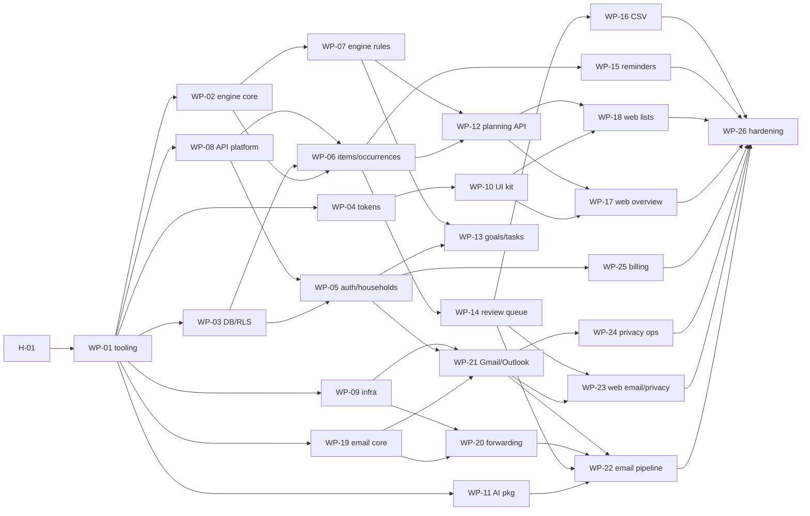

# Work plan for coding agents

The MVP and P1 backlog is split into **work packages (WPs)** that one coding agent can finish in one or more sessions. Every WP lists:
- **Owns:** the only paths the agent should change. This keeps parallel agents from colliding.
- **Read first:** the spec sections that define the work.
- **Acceptance:** checkable criteria. A reviewer agent and CI verify them.

Rules for running WPs: [PLAYBOOK.md](PLAYBOOK.md). Rules for code: [CLAUDE.md](../../CLAUDE.md).

**Status values:** `todo` · `in-progress (agent/branch)` · `in-review` · `done` · `blocked (reason)`. Update the status table in the same PR that changes a WP’s state.

**Sizes:** S ≈ one session · M ≈ 2–3 sessions · L ≈ 4+ sessions (split if it grows).

---

## Status

| WP | Title | Wave | Depends on | Size | Gate | Status |
|---|---|---|---|---|---|---|
| H-01 | Human setup: accounts, decisions, repo protections | 0 | — | — | — | todo |
| WP-01 | Monorepo, tooling, CI skeleton | 1 | H-01 | M | — | done |
| WP-02 | Engine core: window, runway, safe to spend, schedules | 1 | WP-01 | M | — | done |
| WP-03 | DB foundation: roles, RLS, migrations, `withHouseholdTx`, RLS test harness | 1 | WP-01 | M | G1 | done (G1 approved) |
| WP-04 | Format + design tokens packages | 1 | WP-01 | S | — | done |
| WP-05 | Auth adapter, identity, households, invites | 2 | WP-03, WP-08 | M | G1 | done (G1 approved) |
| WP-06 | Items, schedules, renewals, occurrences | 2 | WP-03, WP-02, WP-08 | L | G1 | done (G1 approved) |
| WP-07 | Engine rules complete (flags, estimates, what-if, shortfall, goals, renewals, averages, calendar) | 2 | WP-02 | L | — | done |
| WP-08 | API platform + contracts (server, errors, idempotency, OpenAPI, client gen) | 2 | WP-01 | M | — | done |
| WP-09 | Infrastructure (CDK: dev + staging) | 2 | WP-01, H-01 | L | G2 | todo |
| WP-10 | UI kit (web components per DESIGN_SPEC §4) | 2 | WP-04 | L | — | done |
| WP-11 | AI package + eval harness | 2 | WP-01 | M | G3 | done (G3 open: live eval pending) |
| WP-12 | Planning API: plan, what-if, calendar, renewals, bills, snapshots | 3 | WP-06, WP-07, WP-08 | M | — | done |
| WP-13 | Goals, proposals, tasks | 3 | WP-05, WP-07, WP-08 | M | — | done |
| WP-14 | Review queue + applied changes (undo) | 3 | WP-06, WP-08 | M | — | done |
| WP-15 | Reminders + notifications (SES) | 3 | WP-06, WP-08 | M | — | in-progress (wp-builder, wp/15-notify) |
| WP-16 | CSV import + recurring detection | 3 | WP-14 | M | — | in-progress (wp-builder, wp/16-csv-import) |
| WP-17 | Web: shell, sign-in, Overview (incl. shortfall), Calendar | 3 | WP-10, WP-08 (WP-12 for live data) | L | — | done |
| WP-18 | Web: Bills, Renewals, Goals, Tasks | 3 | WP-10, WP-08 (WP-12, WP-13 for live data) | L | — | in-progress (wp-builder, wp/18-web-pages) |
| WP-19 | Email core: MIME/PDF→text, redaction, prefilter, matcher | 3 | WP-01 | M | — | done |
| WP-20 | Forwarding channel (SES inbound) | 4 | WP-19, WP-09 | M | G2 | todo |
| WP-21 | Gmail + Outlook connectors, token crypto | 4 | WP-05, WP-19, WP-09 | L | G2 | todo |
| WP-22 | Email processing pipeline + auto-apply | 4 | WP-11, WP-14, WP-19, (WP-20 or WP-21) | L | G3 | todo |
| WP-23 | Web: Email & imports, Members & privacy, setup flow, review UI | 4 | WP-10, WP-14, WP-21 | L | — | in-progress (wp-builder, wp/23-web-imports-settings) |
| WP-24 | Privacy ops: export, leave, delete, retention, activity | 4 | WP-05, WP-21 | M | G2 | todo |
| WP-25 | Billing + entitlements | 4 | WP-05, WP-08 | M | — | in-progress (wp-builder, wp/25-billing) |
| WP-26 | Hardening: security, observability, E2E, load | 4 | WP-12…WP-25 | L | G4 | todo |
| WP-27 | P1 · Explain (AI text) + number validator | P1 | WP-11, WP-12 | M | G3 | todo |
| WP-28 | P1 · Ask MoneyPilot (engine tools, SSE) | P1 | WP-27 | L | G3 | todo |
| WP-29 | P1 · Realtime invalidation (SSE) | P1 | WP-12 | S | — | todo |
| WP-30 | P1 · Mobile app (React Native CLI) | P1 | WP-08, WP-04 | L | — | todo |
| WP-31 | P1 · Bank adapter (Plaid) in staging | P1 | WP-16 | M | G2 | todo |

**Human gates:**
- **G1:** schema, RLS and auth review, before features build on them.
- **G2:** security review before real inboxes, real credentials or infrastructure changes.
- **G3:** AI prompt and eval review before auto-apply or AI text reaches users.
- **G4:** pre-pilot review: DESIGN_SPEC §9 checklist, pen-test-lite and runbooks.

**Suggested parallel lanes:**
- Wave 1: WP-02, WP-03 and WP-04 after WP-01 (3 agents).
- Wave 2: WP-05, WP-06 (after WP-08), WP-07, WP-08, WP-10, WP-11 (up to 4 agents at a time).
- Wave 3: WP-12, WP-13, WP-14, WP-15, WP-19, then WP-17, WP-18, WP-16.
- Wave 4: WP-20, WP-21, then WP-22, WP-23, WP-24, WP-25, then WP-26.

Frontend WPs (WP-17, WP-18, WP-23) can start before their APIs exist, using the generated client with **MSW mocks fed by the golden fixture**.

---

## H-01 · Human setup (not an agent task)
- Make the decisions in BACKEND_PLAN §17: hosting, auth, billing, product name/domain, AI model policy.
- CI: the `visual` and `web-e2e` jobs run on `ubuntu-24.04-arm`, which is free only for public repos. On a private repo, enable a larger arm64 runner or move those jobs to x86 and regenerate the baselines there.
- Create: GitHub repo (branch protection on `main`, required checks, CODEOWNERS for `design/`, `docs/`, `packages/db/migrations/`, `infra/`); AWS Organization with dev, staging and prod accounts; Cognito user pools per environment (WP-09); Google Cloud project + OAuth consent (**start Gmail verification**); Microsoft app registration; SES domain + production access request; Anthropic API keys per environment; billing sandbox.
- CI secrets: **dev and staging only**. Agents never receive production credentials.

## WP-01 · Monorepo, tooling, CI skeleton
- **Owns:** repo root config (`package.json`, `pnpm-workspace.yaml`, `turbo.json`, `tsconfig.base.json`, `.eslintrc*`, `.dependency-cruiser.cjs`, `.github/workflows/**`, `.github/dependabot.yml`, `docker-compose.yml`, `docker/**`, `.env.example`, `.gitignore`, `.prettier*`, `eslint.config.js`, `tooling/**`), skeleton `package.json` + `src/index.ts` in every app and package listed in CLAUDE.md.
- **Read first:** CLAUDE.md; ARCHITECTURE §3, §8; BACKEND_PLAN §2.1, §3, §4.
- **Build:** pnpm + Turborepo; TS strict base config; Vitest; ESLint (including a no-hex/no-raw-px rule for `apps/web` and `packages/ui`, and a no-`console` rule); dependency-cruiser encoding ARCHITECTURE §3 rules; Docker Compose (Postgres 16, MinIO, Mailpit); all scripts from CLAUDE.md (no-op where the package is empty); a GitHub Actions workflow running lint, typecheck, test, dep-cruise and contracts drift (stubbed).
- **Acceptance:**
  - [ ] `pnpm install && pnpm lint && pnpm typecheck && pnpm test` pass on a clean clone.
  - [ ] dependency-cruiser fails a deliberate violation test (e.g. `apps/web` importing `packages/db`).
  - [ ] The no-hex lint rule fails on a fixture file containing `#12201B` in `apps/web`.
  - [ ] `docker compose up` starts Postgres, MinIO and Mailpit; `pnpm dev` starts empty api, worker and web.
  - [ ] CI runs on PRs and is required on `main`.

## WP-02 · Engine core
- **Owns:** `packages/engine/**`
- **Read first:** DESIGN_SPEC §6 rules 1–5, 7; BACKEND_PLAN §7.2; fixture `expected` (planningWindow, runwayEndOfDayCents, lowest, safeToSpend*, perDayDisplay, billsBeforePayday); ADR-005, 006, 007.
- **Build:** `types.ts` (EngineInput, PlanResult); `schedule/` (Schedule union ↔ RRULE, expansion between dates with the weekend rule, a US federal holiday table); `planningWindow`, `projectRunway`, `safeToSpend`, `perDay`, `billsBeforePayday`, `math` lines; a fixture loader for tests.
- **Acceptance:**
  - [ ] The golden test asserts every listed `expected` value from `rivera-household.json`.
  - [ ] Property tests: runway balance on day n equals start plus the sum of events up to n; safe to spend ≤ lowest point; moving a bill later never lowers the lowest point within the window.
  - [ ] Schedules: monthly 1st, last day, last Friday, biweekly from anchor, every 6 months, yearly, each with unit tests including month-end and leap year.
  - [ ] DST and timezone tests (America/Los_Angeles, Pacific/Honolulu).
  - [ ] No imports outside the package, no `Date.now()`, no randomness (lint).
- **Human review:** calculation correctness.

## WP-03 · DB foundation
- **Owns:** `packages/db/**` (runner, roles, helpers, identity and household tables only), `scripts/test-rls/**`
- **Read first:** BACKEND_PLAN §5.1–5.3; ADR-003, ADR-015; ARCHITECTURE §5.
- **Build:** a timestamped SQL migration runner; roles `mp_api`, `mp_worker`, `mp_migrator`, `mp_analytics`; `app_user_id()` / `app_household_id()`; the `version` trigger helper; tables `users`, `households`, `household_members`, `invites`, `audit_events`, `idempotency_keys`, `webhook_events`; Drizzle schema mirrors; `withHouseholdTx(ctx, fn)` and `withJobTx(householdId, fn)`; a seed loader that inserts fixture members and households; the RLS test harness (`pnpm test:rls`). The harness lists every table with `household_id` from `information_schema` and **fails if a table has no cross-tenant test**.
- **Acceptance:**
  - [ ] Migrations apply on an empty DB and are idempotent on re-run.
  - [ ] User A gets 0 rows from household B on every table (select, insert, update, delete attempts).
  - [ ] `audit_events` rejects UPDATE and DELETE for app roles.
  - [ ] The harness fails when a new table with `household_id` is added without a test (meta-test).
  - [ ] RLS tests connect as `mp_api` / `mp_worker` (`DATABASE_URL`, `WORKER_DATABASE_URL`), never as the migrator or a superuser. Local roles come from `docker/postgres/init.sql`.
  - [ ] The `migrate`, `seed` and `test:rls` placeholder scripts in `packages/db/package.json` are replaced. They fail on purpose once `packages/db/migrations` exists.
- **Gate:** G1.

## WP-04 · Format + tokens
- **Owns:** `packages/format/**`, `packages/ui/src/tokens/**`
- **Read first:** DESIGN_SPEC §2, §7; `design/tokens.json`, `design/tokens.css`.
- **Build:**
  - `format`: `money(cents, {mode: 'detail'|'headline'|'signed'|'estimate'})`, `shortfall(cents)` (“$793 short”), `date(plainDate, {weekday, relativeTo})`, `relative(days)`, `maskLast4`, `maskEmail`.
  - `ui/tokens`: a typed TS export generated from `tokens.json` plus CSS variables; a script that verifies `tokens.css` matches `tokens.json`.
- **Acceptance:**
  - [ ] Every example in DESIGN_SPEC §7 is a test case (e.g. `−$389.00`, `~$142.00`, `Jan 9, 2027`, `•••4821`, `sam•••@gmail.com`, `$793 short`).
  - [ ] The token consistency check fails if the two files diverge.

## WP-05 · Auth, identity, households, invites
- **Owns:** `apps/api/src/auth/**`, `apps/api/src/modules/{identity,households}/**`, the matching contracts files.
- **Read first:** BACKEND_PLAN §6, §8.2 (me, households, invites, leave); ADR-017.
- **Build:** the auth provider interface + Cognito implementation (`aws-jwt-verify` access-token check, step-up from `mfa_enabled` and `auth_time`), a fake issuer with a local JWKS for tests, `/me/bootstrap`, `/me`, household create/read/patch, the summary endpoint (members, badges stubbed), invites (create, revoke, accept with email match), leave (reassignment hooks stubbed), audit events.
- **Acceptance:**
  - [ ] Two seeded users join one household via invite; a third user can’t read it (RLS + API test).
  - [ ] An expired, revoked or mismatched-email invite returns the right problem codes.
  - [ ] Step-up is required on the endpoints marked in BACKEND_PLAN §8.2 (`mfa_required`).
  - [ ] The OpenAPI client regenerates without drift.
  - [ ] Invites are accepted only through `app_accept_invite` and looked up only through `app_invite_lookup` (WP-03). The mismatch hint shows the masked email from the lookup.
  - [ ] A WP-05 migration grants `app_sync_auth_user` to `mp_api` (ADR-017). It is called only from bootstrap, with the email from a verified token whose `email_verified` claim is true. Tokens with `email_verified = false`, the wrong `token_use`, client id or issuer, or an expired `exp`, are rejected (tests for each).
  - [ ] `/me/bootstrap` takes the user's email from the verified token claims, never from the request body.
- **Gate:** G1.

## WP-06 · Items, schedules, renewals, occurrences
- **Owns:** `apps/api/src/modules/items/**`, `apps/worker/src/jobs/occurrences/**`, `packages/db/migrations/*_wp06_*`, items contracts.
- **Read first:** BACKEND_PLAN §5.2 (recurring_items through planned_expenses, balances), §7.1, §7.5; DESIGN_SPEC §5 screens Bills and Renewals (fields); ADR-006.
- **Build:** tables + RLS + tests; items CRUD with the `Schedule` union (converted with the engine’s schedule utils), renewal details, amount history, balances, planned expenses; the occurrences materializer job (−35 to +400 days, rebuild on change); occurrence PATCH (paid, received, actual, move, skip); `If-Match` versioning.
- **Acceptance:**
  - [ ] Seeding the fixture produces occurrences whose November dates match the calendar in DESIGN_SPEC §5.1 (16 bills, 3 paychecks).
  - [ ] A schedule change rebuilds only future `scheduled` occurrences; paid ones are untouched.
  - [ ] A stale `If-Match` returns 409 with the current resource.
  - [ ] RLS tests cover all new tables.
  - [ ] `recurring_items.subcategory`, `movable`, `on_bills_page` and `goals.is_emergency_fund` exist (BACKEND_PLAN §5.2). Seeding the fixture stores each renewal as an item; renewal-only ones get `on_bills_page = false`, and r-car links to the car insurance item (Q-020).
  - [ ] The engine input carries `onBillsPage`, and `billsAverages` skips items where it is false (small cross-WP change in `packages/engine`), so the bills page still shows 18 rows and $4,956.94 (DESIGN_SPEC §6 rule 17).
  - [ ] Household PATCH accepts `primaryIncomeItemId`, checked to be an income item in the same household (Q-086); a cushion change recomputes the plan.
  - [ ] WP-05's leave hook reassigns the leaver's owned items to the remaining member (`LeaveHooks.reassignOwnedItems`).
- **Gate:** G1.

## WP-07 · Engine rules complete
- **Owns:** `packages/engine/src/rules/**` (+ tests)
- **Read first:** DESIGN_SPEC §5.3 (shortfall), §6 rules 6, 8–17; BACKEND_PLAN §7.2 table; fixture `expected` (all remaining keys) and `scenarios.shortfall`.
- **Build:** `estimate`, `flags`, `decisions` (ranked with `templateText`), `whatIf`, `shortfallOptions`, `goalStatus`, `suggestMonthly`, `renewalsSummary`, `billsAverages`, `calendarMonth`, `tasksDueThisWeek`.
- **Acceptance:**
  - [ ] Every value under `expected` and `scenarios.shortfall.expected` is asserted, including the options ($507 / $107 / −$109) and “Mar 2028”.
  - [ ] Moving car insurance to payday returns safe to spend $1,691.01; an actual electricity bill of $151.37 returns $997.64.
  - [ ] Flags fire for exactly the fixture items listed in DESIGN_SPEC (not usual month, price up ×2, possible duplicate, estimate ×2, decide by, not automatic).
  - [ ] 100% branch coverage on `rules/`.

## WP-08 · API platform + contracts
- **Owns:** `apps/api/src/{server.ts,plugins/**,lib/**}`, `packages/contracts/src/{common,errors}/**`, the client generation script.
- **Read first:** BACKEND_PLAN §8.1, §8.4; ADR-008; ARCHITECTURE §5.
- **Build:** Fastify server with the Zod type provider; a module registry; `AppError` → problem+json; Idempotency-Key plugin; `If-Match` helper; rate limits; request context (user, household); OpenAPI generation at `/v1/openapi.json`; `pnpm contracts:gen` with a `--check` drift mode; webhook verification helpers (signature, SNS, OIDC) as utilities. Fastify logs through `createLogger` from `@mp/observability`, and logged request URLs have their query strings stripped (OAuth `code` and `state`). Replace the `contracts:gen` placeholder script, which fails on purpose once `packages/contracts/src/openapi` exists.
- **Acceptance:**
  - [ ] Repeating a POST with the same Idempotency-Key returns the stored response; a different body with the same key returns 422.
  - [ ] Every error path returns RFC 9457 JSON with a `code`.
  - [ ] CI fails if the committed client differs from generated output.

## WP-09 · Infrastructure (CDK)
- **Owns:** `infra/**`
- **Read first:** BACKEND_PLAN §4, §10; ARCHITECTURE §6; ADR-012.
- **Build:** a VPC (public, private and isolated subnets, 2 AZs); RDS Postgres 16 (Multi-AZ in staging off and prod on; PITR 14d); ECS Fargate services for api and worker; ALB + WAF; S3 buckets (uploads, inbound mail, exports) with SSE-KMS and lifecycle rules; KMS keys (token CMK with a key policy limited to the worker role); SES (sending identity, configuration set, inbound receipt rule → S3 + SNS); Secrets Manager; least-privilege IAM per service; GitHub OIDC deploy role for **dev and staging only**.
- **Acceptance:**
  - [ ] `cdk synth` is clean; `cdk diff` is reviewed by a human.
  - [ ] The api task role cannot `kms:Decrypt` with the token key (IAM policy test / cdk-nag).
  - [ ] cdk-nag passes, with justified suppressions only.
  - [ ] The pre-token-generation trigger emits `email`, `email_verified`, `mfa_enabled` and `mfa_verified_at` (ADR-018); federated sign-ins must pass our TOTP challenge before `mfa_verified_at` is set.
  - [ ] Account linking (if any) links two identities only when both have a verified email (Q-083); the pool forbids unverified email attribute updates.
  - [ ] The API exits at startup in production when `COGNITO_*` is missing or inconsistent.
  - [ ] A dedicated `mp_queue` database role (no BYPASSRLS, no access to `public` tables) owns pg-boss; the `pgboss` schema is created by a migration step and pg-boss runs with `migrate: false` in production (Q-105). The API may enqueue only through a narrow SECURITY DEFINER function for allowlisted queues with a household uuid, never raw INSERT on `pgboss.job`.
- **Gate:** G2 (human applies to AWS).

## WP-10 · UI kit
- **Owns:** `packages/ui/src/components/**`, `packages/ui/.storybook/**`
- **Read first:** DESIGN_SPEC §2–§4, §8; the canvas “Design specification v1.0” board.
- **Build:** React components exactly as specified: Button (primary, secondary, text, icon, destructive, disabled), SegmentedControl, FilterPills, StatusChip (ok, attention, info, estimate), Card (standard, hero, hero-shortfall, attention), KpiTile, Avatar/OwnerDot, ProgressBar, Switch, RadioCard, Stepper, Input/Select, SidebarNav, TabBar (web preview), Table, ListRow, MathBreakdown, ReviewQueueItem, RunwayChart (incl. negative bars), CalendarCell/EventChip, EmptyState, Skeleton, ErrorBanner. Stories for every state. Add stylelint for CSS files (no hex or raw px outside the token files), matching the ESLint rule from WP-01 (ARCHITECTURE §8).
- **Acceptance:**
  - [ ] Tokens only (the lint rule passes); every interactive element is keyboard-reachable with a visible focus ring; axe passes in Storybook.
  - [ ] Visual snapshots of RunwayChart rendered with fixture values (normal and shortfall).
  - [ ] The `ui-fidelity-reviewer` agent finds no blocking deviations from DESIGN_SPEC §4.

## WP-11 · AI package + eval harness
- **Owns:** `packages/ai/**`
- **Read first:** BACKEND_PLAN §7.8.2 (schema, validation), §7.9; ADR-010; CLAUDE.md “AI in product code”.
- **Build:**
  - `config.ts` (model per route; default `claude-opus-5-5`; effort per route).
  - A client wrapper (official SDK, `inference_geo: "us"`, refusal handling, typed error retries, `ai_runs` metering callback).
  - Extraction: Zod schema → JSON Schema via `output_config.format`; prompt `extract.v1.md` with a cached system prefix; Batch API helpers for backfill.
  - A fake client for tests.
  - An eval runner (`pnpm ai:eval`) over a corpus format `{email_text, expected_fields}` with gates (field precision, irrelevant recall, schema validity, injection corpus).
- **Acceptance:**
  - [ ] Unit tests run entirely on the fake client; no network in CI unit tests.
  - [ ] The eval runner produces a report and fails below the gates; a budget cap is enforced.
  - [ ] Injection test cases (“ignore previous instructions…”) never change output shape or produce out-of-evidence values.
- **Gate:** G3 (human reviews the prompt and the first eval report).

## WP-12 · Planning API
- **Owns:** `apps/api/src/modules/planning/**`, `apps/worker/src/jobs/plan/**`, planning contracts.
- **Read first:** BACKEND_PLAN §7.2, §8.2–8.3; ARCHITECTURE §4.1–4.2; DESIGN_SPEC §5.1 golden values.
- **Build:** the engine input projection; `calc_snapshots`; `GET /plan`, `POST /plan/what-if`, `GET /calendar`, `GET /renewals` + summary, bills averages (on the items list response); the `plan.recompute` job (debounced singleton).
- **Acceptance:**
  - [ ] With the fixture seeded, `GET /plan` returns exactly the `expected` values; the shortfall scenario seed returns `scenarios.shortfall.expected`.
  - [ ] p95 < 300 ms locally for the fixture household.
  - [ ] Snapshot deduplication by `inputs_hash`; `calcSnapshotId` is stable across identical reads.
  - [ ] One shared DB pool provider for API modules (closed on shutdown), replacing per-module pools such as WP-06's items module.
  - [ ] The nightly occurrence sweep is registered in pg-boss and fans out with `app_list_household_ids()` (WP-06, Q-051).

## WP-13 · Goals, proposals, tasks
- **Owns:** `apps/api/src/modules/{goals,tasks,proposals}/**`, `apps/worker/src/jobs/{proposals,tasks}/**`, related migrations and contracts.
- **Read first:** BACKEND_PLAN §7.3, §7.4; ARCHITECTURE §4.5; DESIGN_SPEC §5.1 Goals and Tasks.
- **Acceptance:**
  - [ ] A proposer can’t approve their own proposal; a stale proposal becomes `superseded`; proposals expire after 7 days.
  - [ ] Goals return the fixture `goalsPage` values; tasks return `tasks` counts and the nav badge of 3.
  - [ ] Auto-complete fires on `actual_amount_received`.
  - [ ] Replace WP-06's interim `approval_required` guard with proposals: deleting a partner's item, changing its owner/status, and moving its due date create a proposal (§7.3). Add the goals write grants together with the proposal gate.
  - [ ] Seed the fixture `tasks` (the 3 / 4 / 3 split, badge 3).

## WP-14 · Review queue + applied changes
- **Owns:** `apps/api/src/modules/review/**`, migrations for `extracted_items`, `applied_changes`, `sender_rules`.
- **Read first:** BACKEND_PLAN §5.2 (email section tables), §7.8.2 (decide), §8.2–8.3 review endpoints.
- **Acceptance:**
  - [ ] Confirm, edit and ignore transition correctly; confirm applies the change atomically with an `applied_changes` row.
  - [ ] Undo restores `before` within `undo_until` and is rejected after it.
  - [ ] The queue API returns the review item payload shape in BACKEND_PLAN §8.3.

## WP-15 · Reminders + notifications
- **Owns:** `packages/notify/**`, `apps/worker/src/jobs/{reminders,notifications}/**`, `apps/api/src/modules/notify/**`, related migrations.
- **Read first:** BACKEND_PLAN §7.6; ARCHITECTURE §4.4.
- **Acceptance:**
  - [ ] Running `reminders.plan` twice creates no duplicates (unique dedupe key).
  - [ ] Send times equal 09:00 household local time across the DST boundary (test with Nov 1, 2026).
  - [ ] Paying or moving an occurrence cancels and re-plans its future notifications.
  - [ ] SES bounce events update delivery status; a hard bounce disables the email channel.
  - [ ] `packages/notify` provides WP-05's `InviteSender` (link `/invite?token=`, names escaped, per-user send quota) and the `invite.accepted` notification to the creator (Q-081, Q-087).

## WP-16 · CSV import + recurring detection
- **Owns:** `packages/detection/**`, `apps/api/src/modules/imports/**`, `apps/worker/src/jobs/imports/**`, migrations for `imports`, `transactions`.
- **Read first:** BACKEND_PLAN §7.7; ARCHITECTURE §4.6.
- **Acceptance:**
  - [ ] Synthetic 13-month CSVs for the fixture household detect all monthly bills, both paychecks (biweekly and last Friday), car insurance (6 months) and water (quarterly), with correct amount types.
  - [ ] Re-importing the same file adds 0 transactions.
  - [ ] An unknown header goes to `needs_mapping`, and the saved mapping is reused for the next file.

## WP-17 · Web: shell, sign-in, Overview, Calendar
- **Owns:** `apps/web/app/(app)/{layout,overview,calendar}/**`, `apps/web/lib/**`, `apps/web/mocks/**`
- **Read first:** DESIGN_SPEC §3, §5.1 Overview + Calendar + Safe-to-spend states, §5.3; canvas boards Web · Overview, Calendar, Safe-to-spend states.
- **Build:** the app shell (sidebar, compact top bar under 800 px), Cognito sign-in with Amplify Auth (our screens, UI kit components), the API client with React Query, MSW mocks from the fixture, the Overview (on track **and** shortfall states, What-if “See the math” drawer) and the Calendar.
- **Acceptance:**
  - [x] With fixture data (mock or seeded), every golden value on the canvas renders exactly.
  - [x] Layout matches at 1440, 1024 and 390 widths (Playwright screenshots attached next to the canvas frames).
  - [x] WP-10 follow-ups: add 1440 visual baselines for RunwayChart and HeroCard, and assert no horizontal page scroll at 1440/1024/390; apply Q-045 to Q-049 in `packages/ui` (icon button 18/`text.secondary`, error banner 12×14 radius lg, calendar cell named from visible content and the axe exemption removed); if CI runs on x86, regenerate the visual baselines there or run the job on an arm64 runner.
  - [x] Loading, empty and error states exist; axe passes; keyboard navigation works through the calendar grid.
  - [x] The web app calls `POST /me/bootstrap` after sign-in and token refresh, so email and MFA changes sync promptly.

## WP-18 · Web: Bills, Renewals, Goals, Tasks
- **Owns:** `apps/web/app/(app)/{bills,renewals,goals,tasks}/**`
- **Read first:** DESIGN_SPEC §5.1 for each screen; canvas boards.
- **Acceptance:** the same as WP-17 for these screens, including the golden values from `billsPage`, `renewals`, `goalsPage` and `tasks`, and the goal stepper and suggestion behavior.

## WP-19 · Email core
- **Owns:** `packages/email/src/{mime,pdf,redact,prefilter,match}/**`, `packages/email/testing/**`
- **Read first:** BACKEND_PLAN §7.8.2; ADR-009.
- **Acceptance:**
  - [ ] Corpus tests: HTML→text keeps amounts and dates; PDFs ≤ 10 pages are extracted; text over 20k characters sets `truncated`.
  - [ ] Redaction keeps the last 4 digits of long numbers and masks card-like numbers, SSNs, phone numbers and other emails (property tests).
  - [ ] Prefilter precision ≥ 95% and recall ≥ 98% on the labeled metadata corpus.
  - [ ] The matcher links fixture emails to the right items (provider domain + last 4).

## WP-20 · Forwarding channel
- **Owns:** `apps/worker/src/jobs/email/inbound/**`, forwarding parts of `apps/api/src/modules/email/**`
- **Read first:** BACKEND_PLAN §7.8.1 (forwarding rules); ARCHITECTURE §4.3.
- **Acceptance:**
  - [ ] Mail from a member’s verified address is processed; mail from unknown senders is `quarantined` and the household is notified.
  - [ ] A Gmail forwarding-confirmation email surfaces the code in-app; no link is ever fetched.
  - [ ] Rotating the address stops acceptance on the old one after 24 h.
- **Gate:** G2.

## WP-21 · Gmail + Outlook connectors, token crypto
- **Owns:** `packages/crypto/**`, `packages/email/src/providers/**`, `apps/api/src/modules/email/**` (connect, disconnect), `apps/worker/src/jobs/email/{discover,backfill,watch}/**`, migrations for `email_connections`, `email_messages`.
- **Read first:** BACKEND_PLAN §5.3 (column grants), §7.8.1, §7.8.3, §10; ADR-009.
- **Acceptance:**
  - [ ] OAuth uses PKCE + a server-side `state`, and step-up MFA is enforced.
  - [ ] Tokens are envelope-encrypted, and only the worker role can read the ciphertext columns (test with the `mp_api` role).
  - [ ] Watch and subscription renewal runs daily; expiry within 24 h raises an alert.
  - [ ] Disconnect revokes at the provider, stops the watch, deletes the token and writes an audit event.
  - [ ] Against fake providers: backfill resumes after interruption; duplicate pushes create no duplicate messages.
  - [ ] WP-05's leave hook revokes the leaver's email connections (`LeaveHooks.revokeEmailConnections`) and the household summary reports the real connection status.
- **Gate:** G2 before any real inbox, including staff test accounts.

## WP-22 · Email processing pipeline
- **Owns:** `apps/worker/src/jobs/email/process/**`, `apps/worker/src/jobs/ai/**`
- **Read first:** BACKEND_PLAN §7.8.2 (all), §7.9; ARCHITECTURE §4.3.
- **Acceptance:**
  - [ ] All validation rules are implemented; a value without a verbatim evidence quote never auto-applies.
  - [ ] The auto-apply policy matches the spec exactly (tested by table); every auto-apply writes `applied_changes` with a 30-day undo.
  - [ ] Backfill goes through the Batch API with results keyed by `custom_id`.
  - [ ] The fixture inbox corpus produces the 4 review items and 3 auto-applied changes shown on the Email & imports board.
  - [ ] `auto_apply` feature flag is off by default.
  - [ ] Use `@mp/review-rules` (WP-14) for the decide policy and apply planning, through a worker-side items-apply port with the same guards as the API; `applied_by` null, `origin` email, undo window from the shared helper.
  - [ ] Map the WP-11 snake_case extraction (fields and evidence field names) to the camelCase review contracts explicitly, with tests.
  - [ ] Run the subject through the WP-19 redactor before writing `extracted_items.message_meta`; `domainMatch` comes only from `isDomainMatch`, and `senderFirstSeen` defaults to true on any error.
  - [ ] The worker writes `providerDomain: null` in `extracted_items.fields` (a model-supplied domain is never trusted; only a user edit sets it), with a test.
- **Gate:** G3 before `auto_apply` is enabled for any household.

## WP-23 · Web: Email & imports, Members & privacy, setup, review UI
- **Owns:** `apps/web/app/(app)/{imports,settings,setup}/**`
- **Read first:** DESIGN_SPEC §5.1 Email & imports, Members & privacy; §5.2 Household setup; canvas boards.
- **Acceptance:** golden behavior as on the canvas (confirm or ignore updates the queue and badge; “Applied automatically” undo; connect flows call `start` and handle the callback; destructive actions use the confirm dialog). Responsive and accessible.

## WP-24 · Privacy ops
- **Owns:** `apps/api/src/modules/privacy/**`, `apps/worker/src/jobs/{exports,deletion,retention}/**`
- **Read first:** BACKEND_PLAN §7.11, §10.
- **Acceptance:**
  - [ ] The export ZIP contains every entity and the activity log; the link expires in 24 h; step-up is required.
  - [ ] Deletion is scheduled for +7 days, can be cancelled by either member, and when executed revokes tokens, cancels billing, removes S3 objects and deletes rows (verified by a test that counts rows per table).
  - [ ] The retention purge follows the schedule table.
  - [ ] Account deletion anonymizes `ip` and `user_agent` on that user's household-less audit events, which otherwise live 2 years (WP-03 G1 re-review).
  - [ ] The retention purge nulls `extracted_items.message_meta` and `evidence` after 13 months and expires `queued` review items after the configured age; soft-deleted items and goals are hard-deleted after the retention period (WP-06 Q-055).
  - [ ] The purge covers `calc_snapshots` older than 90 days that no `ai_texts` row or proposal references, through a SECURITY DEFINER function (Q-104).
- **Gate:** G2.

## WP-25 · Billing + entitlements
- **Owns:** `packages/billing/**`, `apps/api/src/modules/billing/**`
- **Read first:** BACKEND_PLAN §7.10; ADR-013.
- **Acceptance:** webhook idempotency; entitlements gate the Plus endpoints with `entitlement_required`; a downgrade makes Plus features read-only without deleting data.

## WP-26 · Hardening
- **Owns:** `apps/*/src/observability/**`, `e2e/**`, `load/**`, security headers, rate-limit config.
- **Read first:** BACKEND_PLAN §10, §12, §13; DESIGN_SPEC §9.
- **Acceptance:**
  - [ ] An E2E suite covers Journeys 1–3 on the seeded stack.
  - [ ] k6: 10k households, backfill burst and a 1st-of-month reminder storm within the BACKEND_PLAN §12 targets.
  - [ ] Dashboards and alerts exist for every §12 metric.
  - [ ] SAST, dependency and DAST scans are clean or triaged.
  - [ ] Runbooks exist: token key rotation, watch outage, SES bounce spike, restore from PITR.
  - [ ] The idempotency store is database-backed, so a repeated key within 24 h returns the stored response across API instances (§8.1).
  - [ ] Writes to items, occurrences, balances, planned expenses and goals enqueue `plan.recompute` after commit, through WP-09's enqueue function (Q-102).
- **Gate:** G4.

## P1 packages (start only after the Day-60 decision gate)
- **WP-27 Explain:** AI text for decisions, cached per snapshot, plus a number validator (every amount and date in the text must exist in the snapshot) with a template fallback. Gate G3.
- **WP-28 Ask MoneyPilot:** SSE endpoint, engine tools (`get_plan`, `what_if`, `goal_options`, `list_items`, `renewals_summary`) with strict schemas, validator, rate limits, entitlement. Gate G3.
- **WP-29 Realtime:** Postgres LISTEN/NOTIFY → SSE `/events`; web query invalidation.
- **WP-30 Mobile:** React Native CLI app (no Expo; ADR-016) with the mobile screens from the canvas, using the same client, format and token packages; React Navigation, `react-native-keychain` for tokens, FCM push via `@react-native-firebase/messaging`; native builds and store releases through Fastlane.
- **WP-31 Bank adapter:** Plaid in staging behind a flag; compare recurring streams with our detection; report the cost per household. Gate G2.
