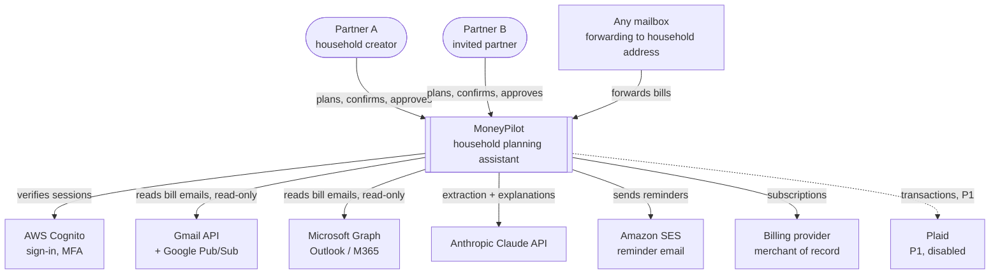
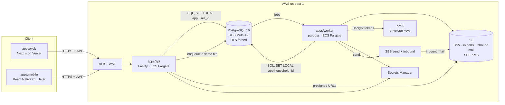
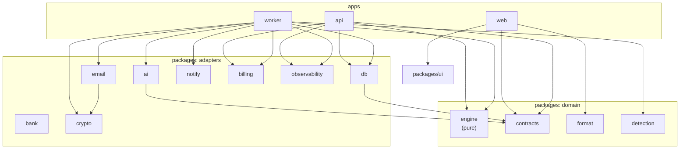
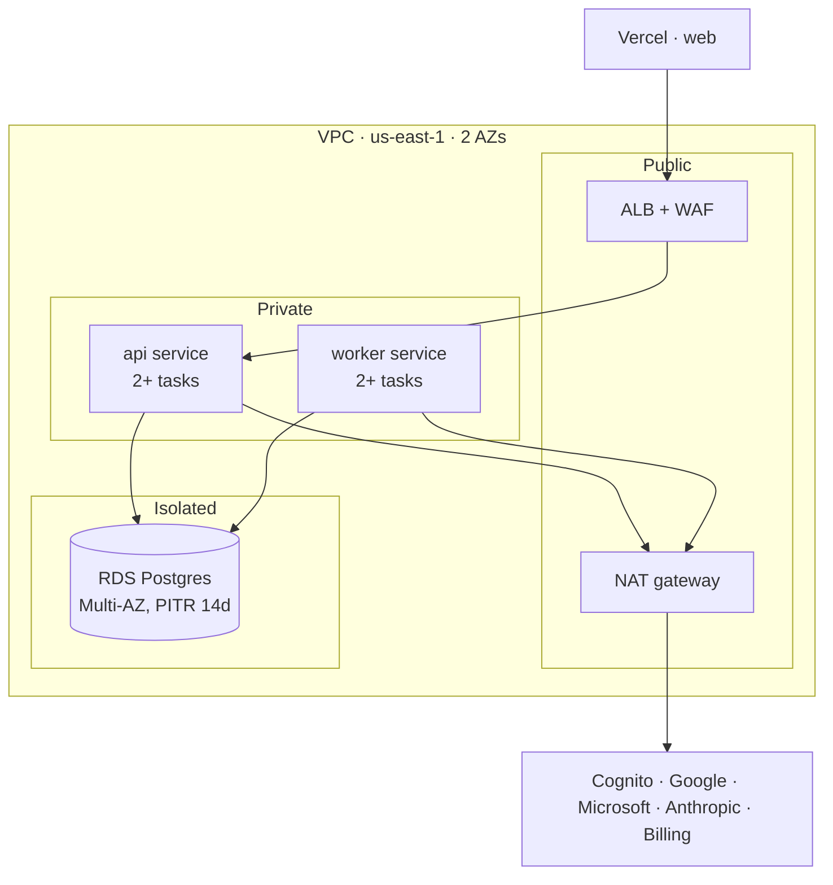

# MoneyPilot AI: Architecture v1.0

This document describes how the system is put together: the context, containers, components, key runtime flows, module boundaries and the architecture rules CI enforces. The detailed schema, endpoints and jobs are in [BACKEND_PLAN.md](../BACKEND_PLAN.md). Screens and calculation rules are in [DESIGN_SPEC.md](../DESIGN_SPEC.md). The reasons behind each choice are in [DECISIONS.md](DECISIONS.md).

---

## 1. System context (C4 level 1)



**What MoneyPilot never does:** move money, pay bills, give regulated financial advice, or read personal mail beyond filtered bill, renewal and receipt messages.

---

## 2. Containers (C4 level 2)



| Container | Responsibility | Scales by |
|---|---|---|
| `apps/web` | UI only. Renders screens from the API; no business logic, no direct DB access. | Vercel |
| `apps/api` | Auth, validation, reads/writes under RLS, engine calls for plan and what-if, webhook intake (verify → enqueue). | ECS task count (CPU) |
| `apps/worker` | Every async and scheduled job: email discovery and processing, AI calls, reminders, imports, renewals, privacy ops. The only holder of decrypted OAuth tokens. | ECS task count (queue depth) |
| PostgreSQL | System of record **and** job queue (pg-boss). | Vertical first, read replica later |
| S3 | Transient files only (CSV until processed, inbound mail until processed, exports for 24 h). | — |

---

## 3. Components (C4 level 3) and dependency rules



**Rules** (enforced by `dependency-cruiser` in CI; see §8):
- `engine` imports nothing internal and nothing that does I/O. It has no `Date.now()` and no randomness.
- `web` never imports `db`, `engine`, `ai`, `email` or `crypto`. Formatting comes from `format`; numbers come from the API.
- Only `worker` imports `crypto` decryption, `email` connectors and the `ai` extraction route. `api` may import `ai` only for Explain and Ask (P1).
- Packages never import apps. Adapters never import each other except `email` → `crypto`.

### 3.1 API modules (`apps/api/src/modules/*`)

| Module | Owns tables | Key endpoints |
|---|---|---|
| `identity` | users | `/me` |
| `households` | households, household_members, invites | `/households`, invites, leave |
| `items` | recurring_items, renewal_details, item_amount_history, occurrences | items, occurrences, renewals |
| `planning` | balances, calc_snapshots, planned_expenses | `/plan`, `/plan/what-if`, `/calendar` |
| `goals` | goals, goal_events, proposals | goals, proposals |
| `tasks` | tasks | tasks |
| `review` | extracted_items, applied_changes, sender_rules | review items, undo |
| `email` | email_connections (management fields only), email_messages (read) | connect/disconnect, forwarding address |
| `imports` | imports, transactions | imports |
| `notify` | notifications, reminder_rules, devices | notifications, preferences |
| `privacy` | data_requests, audit_events (read) | exports, deletion, activity |
| `billing` | subscriptions | billing |
| `webhooks` | webhook_events | `/webhooks/*` (verify → enqueue only) |

A module may **read** another module’s tables only through that module’s service interface, never with a direct SQL join across modules. The exception is `planning`, which reads a read-only projection assembled by `items`, `goals` and `planning` repos for the engine input.

---

## 4. Key runtime flows

### 4.1 Load the overview (`GET /plan`)

```mermaid
sequenceDiagram
  participant W as web
  participant A as api
  participant P as Postgres
  participant E as engine (in-process)
  W->>A: GET /v1/households/:hid/plan (JWT)
  A->>A: verify JWT, load membership
  A->>P: BEGIN; SET LOCAL app.user_id
  A->>P: latest calc_snapshot for household
  alt snapshot fresh (no writes since)
    P-->>A: snapshot.result
  else stale or missing
    A->>P: load EngineInput projection (items, occurrences, balance, goals, planned)
    A->>E: computePlan(input, asOf)
    E-->>A: PlanResult (+ math)
    A->>P: upsert calc_snapshot (inputs_hash)
  end
  A->>P: COMMIT
  A-->>W: 200 PlanResult + calcSnapshotId
```

### 4.2 A partner edits a bill

```mermaid
sequenceDiagram
  participant W as web (Jordan)
  participant A as api
  participant P as Postgres
  participant K as worker
  W->>A: PATCH /items/:id (If-Match: 7)
  A->>P: BEGIN; check version=7; update; version=8
  A->>P: insert audit_event; enqueue occurrences.materialize + plan.recompute + reminders.plan
  A->>P: COMMIT
  A-->>W: 200 item v8
  P-->>K: jobs (same txn → never lost)
  K->>P: rebuild future occurrences; recompute snapshot; re-plan reminders
  Note over W: Sam’s web refetches on focus / 60s poll (SSE in P1) and sees new numbers
```

### 4.3 Email capture (Gmail; Outlook is identical with delta + Graph notifications)

```mermaid
sequenceDiagram
  participant G as Gmail + Pub/Sub
  participant A as api /webhooks/gmail
  participant K as worker
  participant KM as KMS
  participant C as Claude API
  participant P as Postgres
  G->>A: push (historyId), OIDC token
  A->>A: verify OIDC audience + SA
  A->>P: record webhook_event; enqueue email.discover(connection)
  K->>KM: decrypt refresh token (data key)
  K->>G: history.list since cursor
  K->>P: insert email_messages (unique provider_message_id)
  loop each new message
    K->>G: get metadata (From, Subject, Date)
    alt prefilter fails
      K->>P: stage = prefiltered_out
    else passes
      K->>G: get full message
      K->>K: MIME→text, PDF→text, redact (keep last 4)
      K->>C: extract (structured output, no tools, effort low)
      C-->>K: ExtractionResult
      K->>K: evidence + plausibility checks; match to item
      alt safe update of confirmed item
        K->>P: apply change + applied_changes (undo 30d) + plan.recompute
      else anything else
        K->>P: extracted_items (queued) + review notification
      end
      K->>K: discard text from memory
    end
  end
  K->>P: save new cursor
```

### 4.4 Reminder lifecycle

```mermaid
sequenceDiagram
  participant K as worker (reminders.plan, every 15 min)
  participant P as Postgres
  participant D as worker (notifications.dispatch, every min)
  participant S as SES
  K->>P: occurrences in next 35 days × reminder_rules × recipients
  K->>P: insert notifications ON CONFLICT (dedupe_key) DO NOTHING<br/>send_at = due − offset @ 09:00 household local
  D->>P: SELECT … WHERE status='scheduled' AND send_at<=now() FOR UPDATE SKIP LOCKED
  D->>S: send (configuration set)
  D->>P: status=sent; delivery row
  S-->>D: delivery/bounce events via SNS → status update
  Note over K,P: occurrence paid/moved → cancel + re-plan future rows
```

### 4.5 Partner approval (proposal)

```mermaid
sequenceDiagram
  participant S as Sam (web)
  participant A as api
  participant P as Postgres
  participant J as Jordan (web/email)
  S->>A: POST /proposals {goal_change: tahoe monthly 250→313, calcSnapshotId}
  A->>P: insert proposal (pending, expires 7d) + notification for Jordan
  J->>A: POST /proposals/:id/approve
  A->>P: BEGIN; re-validate payload against current data
  alt still valid
    A->>P: apply change + applied_changes + audit; status=applied; enqueue plan.recompute
  else data changed
    A->>P: status=superseded; notify Sam
  end
  A->>P: COMMIT
```

### 4.6 CSV import

`POST /imports` (presigned URL) → the browser uploads to S3 → `POST /imports/:id/process` → `imports.process` job:
1. Parse the file and fingerprint the header row.
2. If the bank isn’t recognized, set `needs_mapping`.
3. Normalize rows, dedupe them into `transactions`, then delete the S3 object.
4. Run `detection.recurring`, which writes `extracted_items` (source csv) to the review queue.

---

## 5. Cross-cutting concerns

| Concern | Approach |
|---|---|
| **Tenancy** | Household = tenant. Forced RLS; `withHouseholdTx` sets session vars; workers scope per job. Cross-tenant tests in CI. |
| **Consistency** | Writes and their follow-up jobs commit in one transaction (pg-boss in Postgres = transactional outbox). Partner edits use `If-Match` versions. |
| **Idempotency** | API `Idempotency-Key`; unique keys on `webhook_events`, `email_messages`, `transactions.dedupe_hash`, `notifications.dedupe_key`, `occurrences(item_id, scheduled_on)`. Every job is safe to run twice. |
| **Time** | Temporal `PlainDate` for bill dates in the household timezone; UTC instants for events; reminders at 09:00 local; DST tests. |
| **Money** | Integer cents end to end; formatting only in `packages/format`. |
| **Errors** | `AppError` → RFC 9457 problem+json. Jobs retry with backoff, then dead-letter with an alert. |
| **Config & flags** | Typed config (Zod) from env and Secrets Manager. Feature flags in a `feature_flags` table (household-scoped) for staged rollout: `gmail_connect`, `auto_apply`, `ai_explain`, `ask`, `bank`. |
| **Observability** | OpenTelemetry traces across api → jobs; pino logs with redaction; Sentry; metrics and alerts per BACKEND_PLAN §12. |
| **Security** | KMS envelope encryption for tokens; step-up MFA for email connect, export and delete; webhook verification; WAF; least-privilege IAM per container. |
| **AI** | `packages/ai` only; config-driven model per route (default `claude-opus-5-5`); versioned prompts; eval gate; number validator; usage metering in `ai_runs`. |

---

## 6. Deployment view



- **Environments:** `local` (docker compose + fakes), `dev`, `staging`, `prod`. Each is a separate CDK stack and a separate AWS account (via Organizations).
- **CI/CD:** GitHub Actions runs lint → typecheck → unit → integration (Testcontainers, RLS) → contracts drift check → build → migrate (gated) → rolling deploy. The web app deploys through Vercel previews per PR.

---

## 7. Data lifecycle

| Data | Created by | Lives in | Removed |
|---|---|---|---|
| Email text | worker (in memory) | never persisted | after the extraction job |
| Email metadata | worker | `email_messages` | 13 months |
| Extracted fields | worker | `extracted_items` | with the household |
| CSV file | browser → S3 | S3 | after processing |
| Transactions | worker | `transactions` | 13 months |
| OAuth tokens | api callback → worker | `email_connections` (encrypted) | on disconnect, leave or delete |
| Exports | worker | S3 | 24 h |
| Audit events | api/worker | `audit_events` | 2 years (tombstone 1 year after deletion) |

---

## 8. Architecture fitness functions (CI gates)

These checks keep the architecture intact while many agents work in parallel. A PR cannot merge if any fails.

| Check | Tool | Protects |
|---|---|---|
| Dependency rules (§3) | dependency-cruiser | Layering, engine purity, token access |
| `pnpm test:rls` covers every table with `household_id` | Custom test that lists tables from `information_schema` and fails if one has no cross-tenant test | Tenancy |
| Engine golden tests equal the fixture `expected` | Vitest | Calculation correctness |
| No hex or raw px in UI code | ESLint rule + stylelint | Design fidelity |
| OpenAPI drift (generated client equals committed) | `pnpm contracts:gen --check` | API contracts |
| Migrations: timestamped, never modified after merge, forward-only | Script comparing against `main` | Safe deploys |
| No `console.*`, no PII fields in log calls | ESLint rule | Privacy |
| Prompt file changed → eval results attached | CI label check + `pnpm ai:eval` | AI quality |
| Bundle and query budgets (P1) | size-limit, pg_stat_statements review | Performance |
